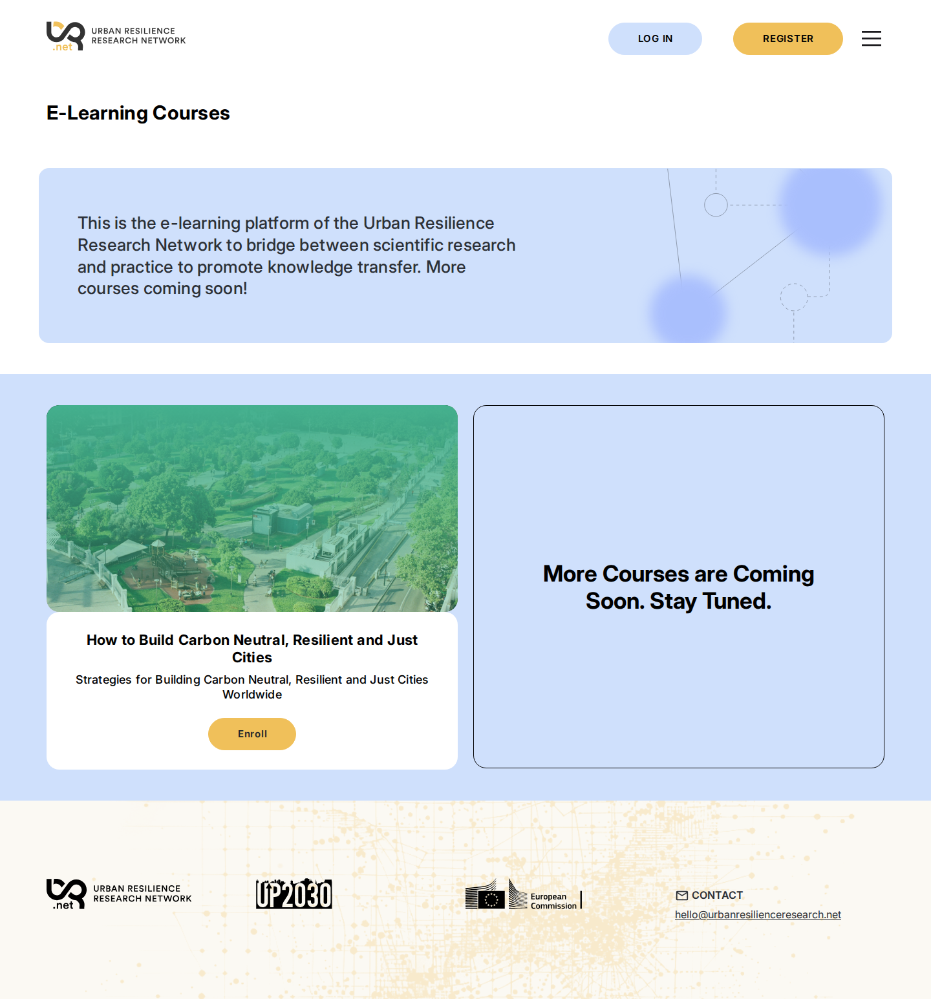
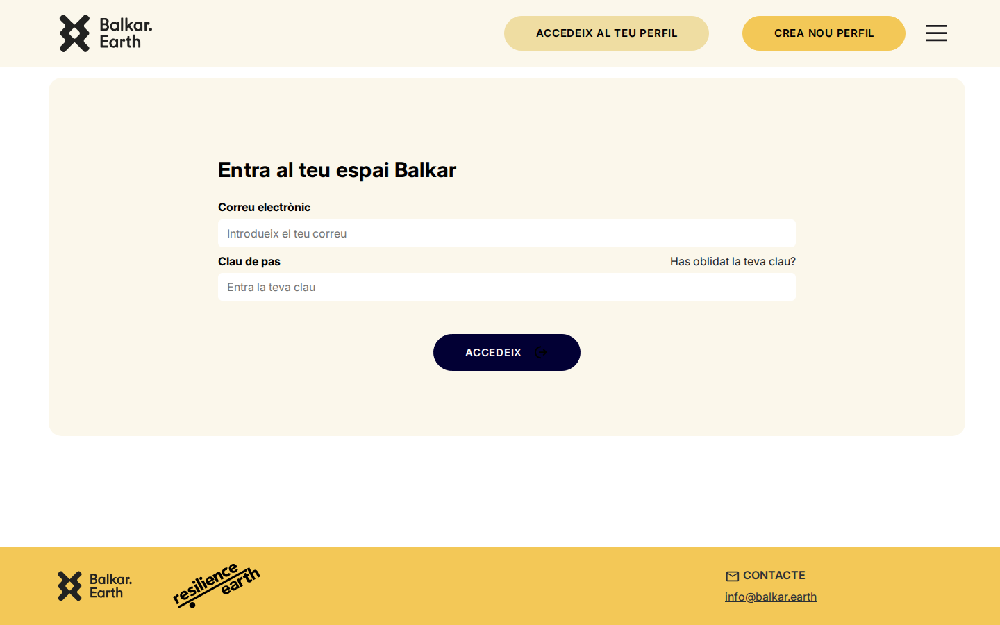
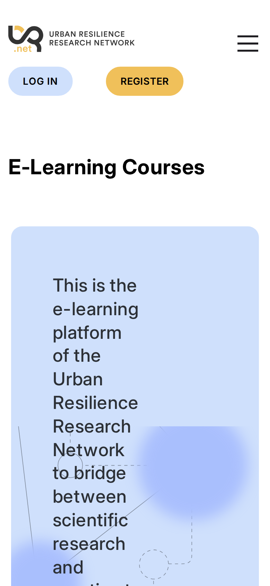
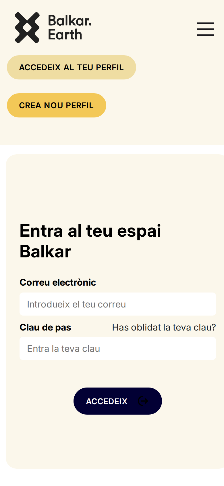

# 1. The platform in one page

## Two sites, one software

URR and Balkar are two separate installations of the same platform. Each has its own database, its own learners and its own admin panel. They look different only because of how each one is **configured in its admin panel**: logo, colours, default language, whether the course catalogue is public.

| | URR | Balkar |
|---|---|---|
| Learner site | edu.urbanresilienceresearch.net | area.balkar.earth |
| Admin panel | api.urbanresilienceresearch.net/admin | api.balkar.earth/admin |
| Default language | English | Catalan (English also available) |
| Home page for visitors | Public course catalogue | Login page |

This is what a visitor sees on each home page:





The difference comes from a single checkbox, **Public home** in the site settings. See [3. Site settings and theme](03-site-settings.md).

Both sites work on phones:

 

## How a course is built

```
Learning space (the course)
├── landing page: banner, description or preview lesson, Enroll / Pay button
├── Module 1                    ← entry in the left-hand menu
│   ├── Unit 1.1                ← a page with content blocks
│   │   ├── Lesson 1.1.1        ← a page with content blocks
│   │   └── Lesson 1.1.2
│   └── Unit 1.2
├── Module 2 …
├── Forum → Channels → Messages (optional)
├── Certificate (optional)
└── Product = price (optional: makes the course paid)
```

Units and lessons are pages made of **content blocks**: text, images, videos, accordions, sliders, quizzes. See [8. Content blocks](08-content-blocks.md).

A learner:

1. registers (a **User** is created),
2. enrolls in a course (an **Enrollment** is created, after paying if the course has a **Product**),
3. reads units and lessons and marks them as completed (**Progress** records),
4. can bookmark pages, talk in the **Forum** and upload files,
5. downloads a **Certificate** when everything is completed.

The platform creates the records in steps 1 to 5 by itself. Administrators mainly create the **course content** (learning spaces, modules, units, lessons, quizzes, forums, certificates, products) and the **site settings** (administration, theme, translations, email templates).

## Glossary

| Term | Meaning |
|---|---|
| **Strapi** | The software behind the admin panel and the data. |
| **Content type / entity** | A kind of record in Strapi, e.g. *Learning space* or *Lesson*. Listed in the left menu of the Content Manager. |
| **Entry** | One record of a content type, e.g. one course. |
| **Component** | A group of fields inside an entry, e.g. a footer logo (image + link + text). |
| **Dynamic zone** | A list of blocks you choose and order freely; this is how unit and lesson pages are built. |
| **Learning space** | A course. |
| **uid** | A technical identifier generated by the platform, used in web addresses: `/space/<uid>/…`. Never edit it. |
| **Draft / Published** | Content that is still being prepared vs. visible on the site. |
| **Locale** | A language version of an entry (`en`, `ca`, `fr`, …). |
| **Manager** | A learner account with access to a course's statistics (the *Admin* tab). Not the same as a Strapi administrator. |
