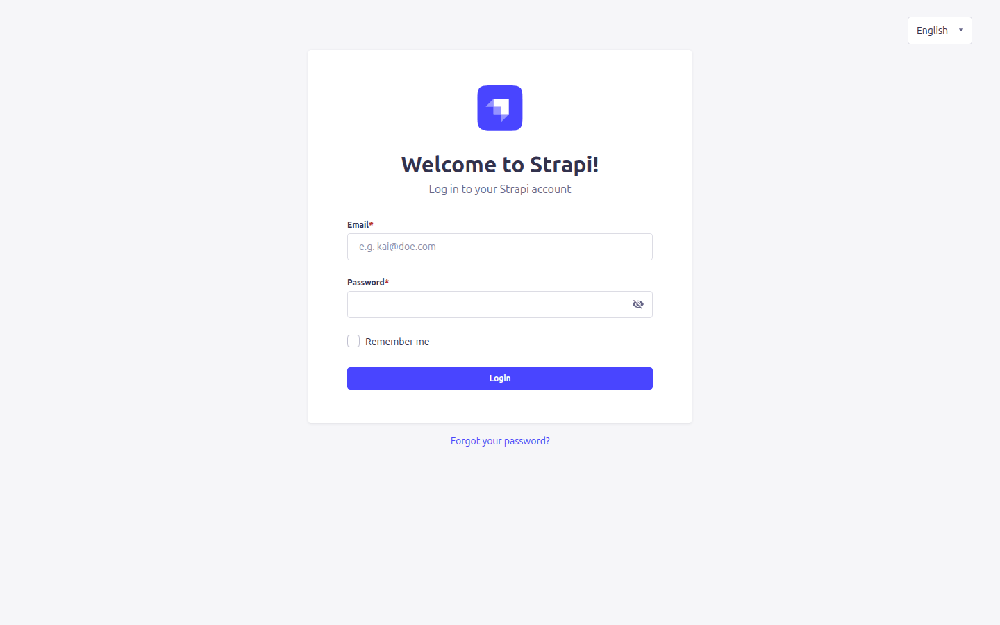
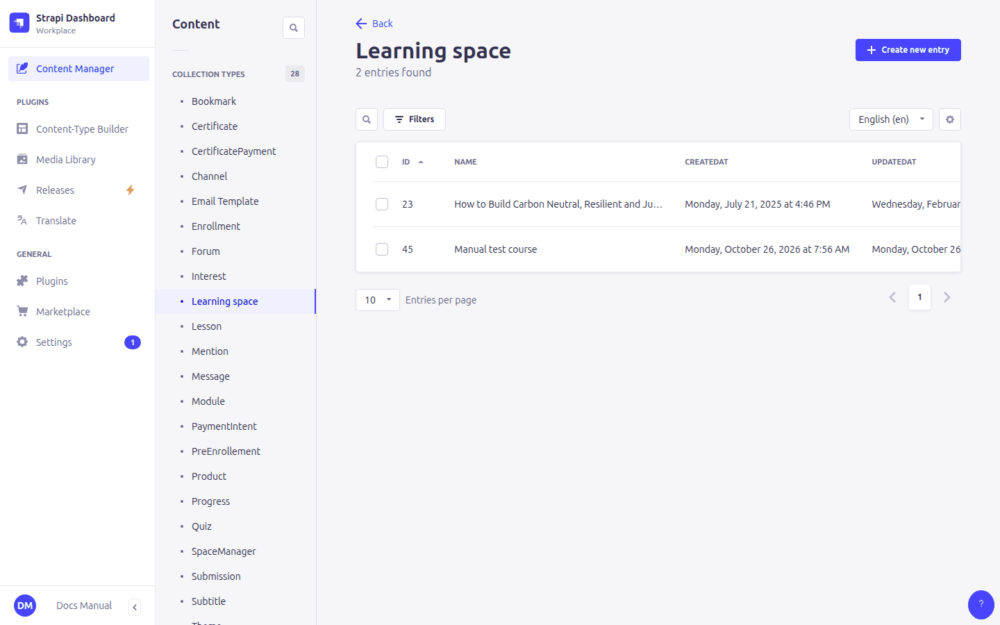
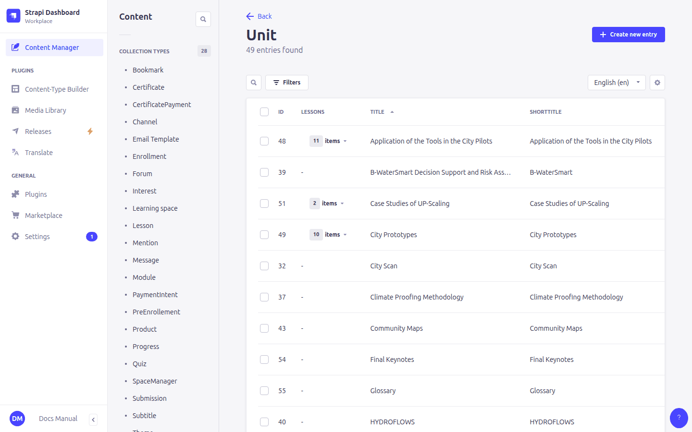
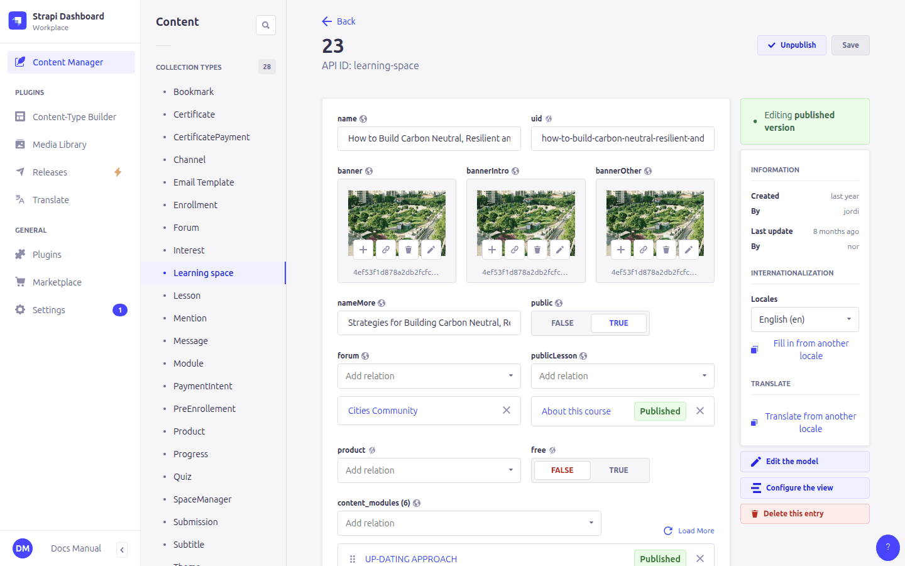
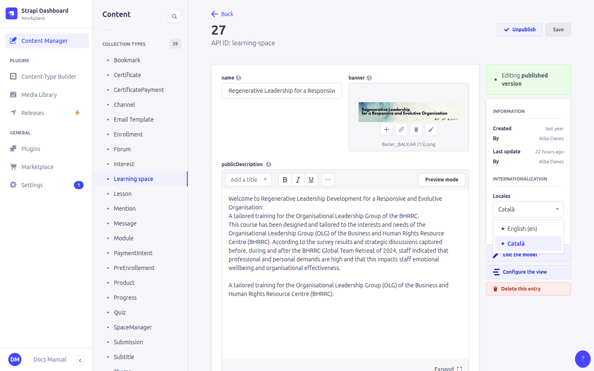
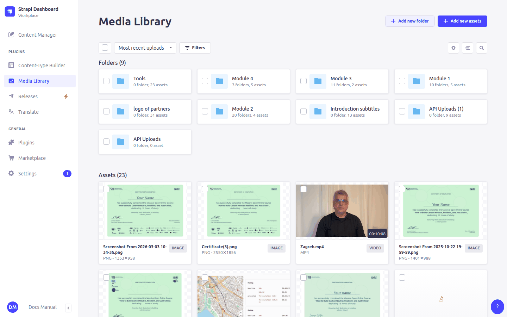

# 2. Working in the Strapi admin panel

## Logging in

Open the admin panel of your site (`https://api.urbanresilienceresearch.net/admin` or `https://api.balkar.earth/admin`) and log in with your administrator email and password. This account is separate from any learner account you may have on the site.

## The Content Manager

Almost all the work happens in **Content Manager** (left menu). It lists two groups:

- **Collection types**: content types with many entries (courses, lessons, users, …).
- **Single types**: content types with exactly one entry. Here there is only **Administration**, the site settings.

Clicking a content type shows its entries (here, the units). You can search, filter, sort by column and choose which columns to show (the gear icon). **Create new entry** is at the top right.

Clicking an entry opens its edit form. Fields are on the left. Relations to other entries (e.g. the course a module belongs to), the language and the publish status are on the right.

Most fields have a short help text under them saying what they change on the site. The texts come from the platform (`src/bootstrap/field-descriptions.ts`) and are set on every start; one changed by hand in **Configure the view** is kept.

> **Tip:** content types that the platform fills in by itself (enrollments, progress, messages, payment records…) are listed in [13. All content types at a glance](13-reference.md). Look at them, but avoid editing them unless a chapter tells you to.

## Draft and published

Courses, modules, units, lessons, quizzes and products have a **draft/published** status. A new entry starts as a **draft**. It is only visible on the site after you click **Publish**. **Unpublish** takes it back to draft.

> ⚠️ For courses this hides the whole course. For modules, units and lessons **inside a published course**, unpublishing currently does *not* hide them. To hide a lesson, remove it from its unit. See [14. Known limitations](14-known-limitations.md).

All other content types (forum, certificate, theme, translations, …) take effect as soon as you click **Save**.

## Languages (locales)

Most content can exist in several languages. The language selector is at the top of the right column of the edit form. Each language version is a **separate entry** with its own fields **and its own relations**.

- **URR** has English plus the EU languages enabled. Balkar has **Catalan** (default) and **English**.
- To translate an entry, open it, switch the language selector to the new language and choose **Fill in from another locale** to copy the content, then translate it.
- Relations are **not** shared between languages. If the Catalan version of a course has a forum, a certificate and a price, the English version needs them linked too.
- Some actions (enrolling, paying, completing lessons, issuing certificates) always use the course's **default-language** version. That version must be complete. See [14. Known limitations](14-known-limitations.md).

Languages are managed in **Settings › Internationalization**. Every language enabled there appears in the learners' *Change language* menu.

## The uid field

Courses, modules, units, lessons, quizzes, forums and channels have a **uid** field. It is the entry's identifier in web addresses, e.g.

`https://edu.urbanresilienceresearch.net/space/how-to-build-carbon-neutral-resilient-and-just-cities/about`

- When you **create** a course, you may type a short readable uid (lowercase words joined by hyphens, as above) to get a nice address. If you leave it empty, the platform generates a random code like `3f2c9a1e-…`. For modules, units and lessons, leave it empty.
- All language versions of an entry share the same uid. That is how a learner's progress carries over when they switch language.
- **Once learners are using a course, don't change any uid**: links, progress and bookmarks would break.

## The media library

Images, videos and PDFs are uploaded in **Media Library** (left menu) or directly from a media field. Fill in the **alternative text** of images: the site uses it when a block has no text of its own.

