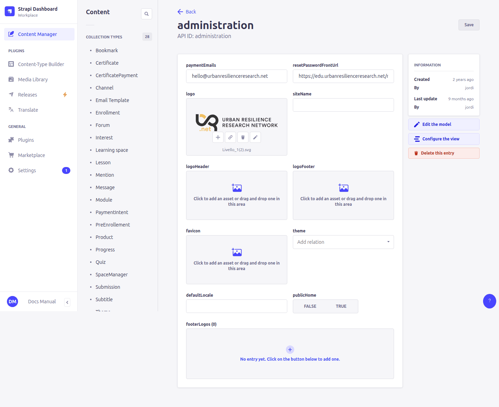
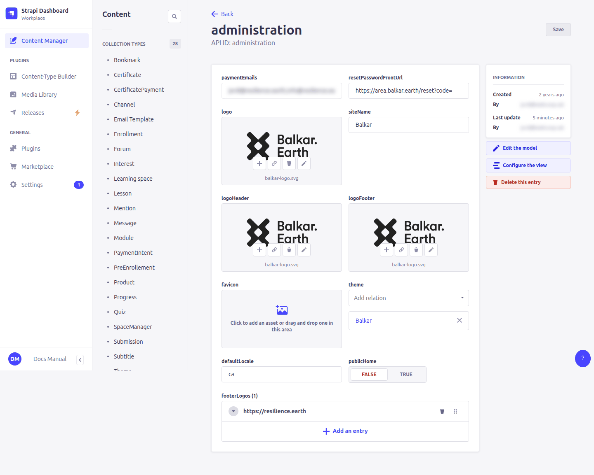
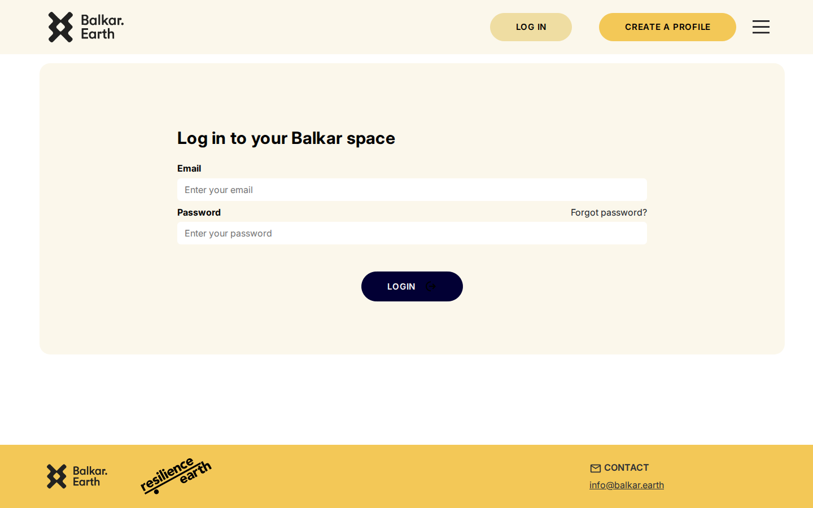
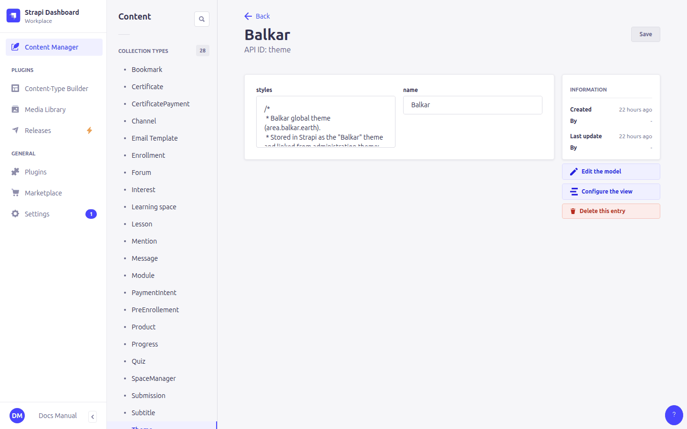

# 3. Site settings and theme

> Content types: **Administration** (single type), **Theme**

## Administration: the site settings

**Content Manager › Single types › Administration** holds the settings for the whole site. There is only one Administration entry per site. Changes apply as soon as you click **Save**; learners see them the next time they load a page.





| Field | What it changes on the site | If left empty |
|---|---|---|
| **Site name** | The browser tab title and the logos' alternative text. | "Urban Resilience Research Network" |
| **Logo header** | The logo at the top left of every page. | The built-in URR logo |
| **Logo footer** | The first logo in the footer. | The built-in URR, UP2030 and European Commission logos |
| **Footer logos** | Extra logos in the footer (partners, funders). Each has an **image**, a **URL** (opens in a new tab) and an **alt** text. They only appear when *Logo footer* is set. | No extra logos |
| **Favicon** | The small icon in the browser tab. | The built-in icon |
| **Theme** | The colour theme of the whole site (see [below](#theme-colours)). | The default green / yellow / light-blue colours |
| **Default locale** | The language for visitors who haven't chosen one, e.g. `ca` or `en`. | English |
| **Public home** | On: visitors see the course catalogue on the home page. Off: visitors are sent to the login page. | On |
| **Logo** | The logo used in the **emails** (confirmation, password reset). It is not shown on the site. | No logo in emails |
| **Payment emails** | Comma-separated addresses that receive the periodic summary of Stripe payments. | No summary sent |
| **Reset password front url** | The start of the link in the password-reset email. It must end with `/reset?code=`, e.g. `https://area.balkar.earth/reset?code=`. | Reset links don't work |

### The same software, two configurations

URR leaves most fields empty and uses the built-in defaults (URR logos, default colours, English, public home):


Balkar sets its own logo for header and footer, a Resilience Earth footer logo, the *Balkar* theme, Catalan as default language, and turns **Public home** off:


### Example: changing the default language

With **Default locale** = `ca`, a first-time visitor to Balkar sees the login page in Catalan (above). Visitors can switch language from the menu, and the site remembers their choice in that browser. This is the same page in English:



You can also link to a public page (login, register, home) in a given language by adding `?locale=en` to its address, e.g. `https://area.balkar.earth/register?locale=en`. Useful in invitation emails.

## Theme: colours

> **Content Manager › Theme**

A **Theme** has a **name** and a **styles** field containing CSS. The CSS overrides the colour variables the site is built on. A theme can be used in two places:

- in **Administration › Theme**: it applies to every page of the site;
- in a course's **Theme** field: it applies only to that course's pages and takes priority over the site theme. See [6. Courses](06-learning-spaces.md#theme).



A theme looks like this (a shortened version of Balkar's; the full one is in `balkar-back/scripts/data/balkar-theme.css`):

```css
:root {
  --theme-primary: #020034;              /* dark blue: main buttons */
  --theme-primary-rgb: 2, 0, 52;         /* the same colour as "r, g, b" */
  --theme-primary-light: #FBF7EB;        /* cream */
  --theme-secondary: #F3C857;            /* yellow: secondary buttons */
  --theme-secondary-rgb: 243, 200, 87;
  --theme-accent-blue-light: #EFDDA2;    /* dark cream: light backgrounds */
  --theme-accent-blue-light-rgb: 239, 221, 162;
  --theme-accent-blue-bg: #FBF7EB;
  --progress-bar-fill: #F3C857;
}
```

(The name `accent-blue` comes from the URR default theme, where that colour is light blue. In a theme you can set it to any colour.)

The main variables:

| Variable | Used for |
|---|---|
| `--theme-primary` (and `-rgb`, `-light`, `-hover`) | Main buttons, progress bar, green video overlay, accordions/sliders in *primary* colour |
| `--theme-secondary` (and `-rgb`, `-light`, `-hover`) | Secondary buttons (e.g. *Register*), yellow video overlay, *secondary* blocks |
| `--theme-accent-blue` (and `-rgb`, `-light`, `-light-rgb`, `-bg`) | Page backgrounds, blue overlay, *tertiary* blocks |
| `--theme-success`, `--theme-warning`, `--theme-error`, `--theme-info` | Messages |
| `--progress-bar-bg`, `--progress-bar-fill` | The course progress bar |
| `--footer-bg` | Footer background |

> ⚠️ Variables ending in **`-rgb`** must contain three numbers separated by commas (`243, 200, 87`), not a `#hex` colour. Video thumbnails use them for their semi-transparent overlay.

Tips:

- Change a theme gradually and check the site after each save. A typo in the CSS can make a whole rule stop working.
- Keep a copy of the CSS before you change it. Strapi keeps no history.
