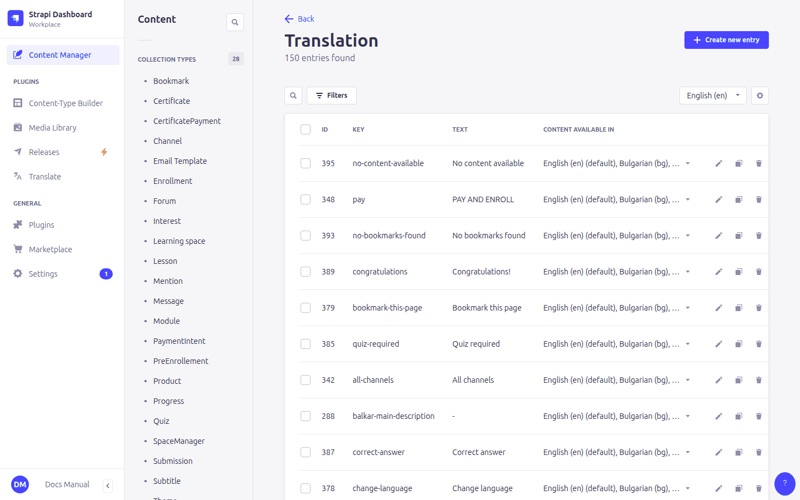
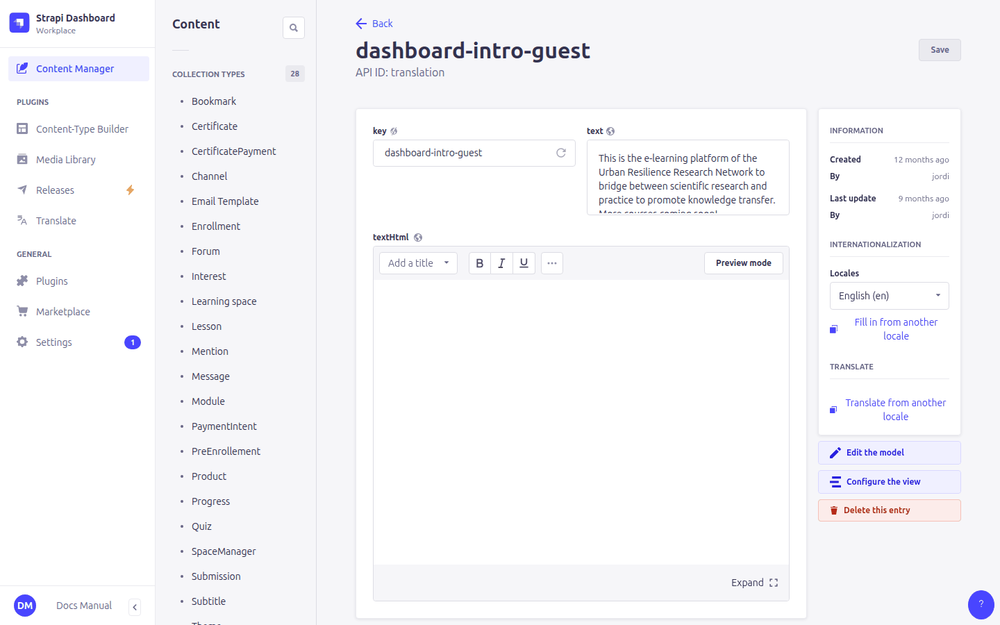
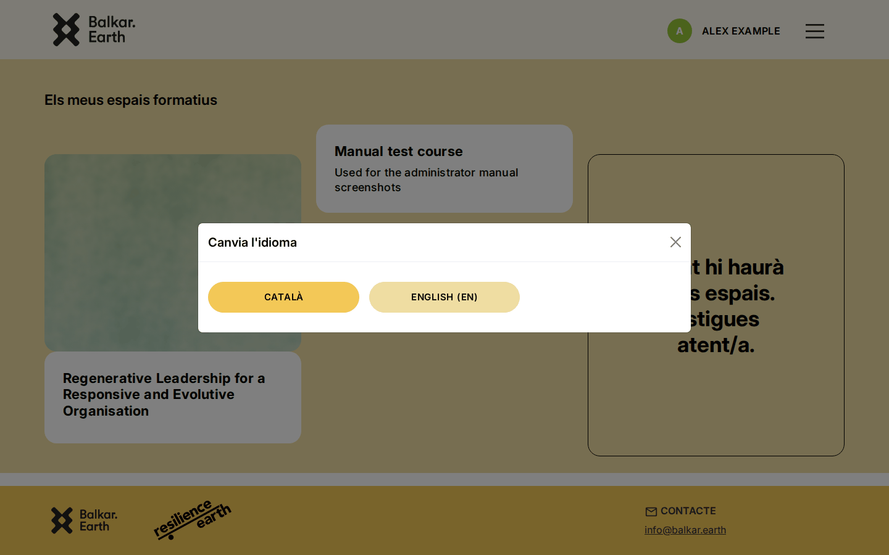

# 4. Interface texts and languages

> Content type: **Translation**

All the fixed texts of the site come from **Translation** entries: buttons, menu items, headings, help messages, the home page introduction, the footer contact. Course content (names, lessons…) is translated in the course entries themselves (see [2. Working in the admin panel](02-admin-basics.md#languages-locales)).

## How a translation entry works

| Field | Meaning |
|---|---|
| **key** | The text's identifier, used by the site, e.g. `dashboard-intro-guest`. |
| **text** | The text, for short plain texts. |
| **textHtml** | A formatted text (bold, links, paragraphs). Used only when *text* is empty. |

Each text has **one English entry, whose key identifies it**, plus one **localization** of that entry per language (created with the language selector on the right). The site:

1. loads all English entries,
2. for each one, uses the localization in the learner's language,
3. falls back to English if there is no localization.

If a key has no entry at all, the site shows the key itself (e.g. `free-course`). That usually means an entry is missing.

> ⚠️ Always add a new language version as a **localization of the English entry** (language selector › create). A separate entry with the same key in another language is ignored. The `key` field of localized versions doesn't matter (Balkar's are named `<key>-ca` because keys must be unique).

## Example: the home page introduction

The introduction box on the URR home page is the key `dashboard-intro-guest`, and the heading above it is `dashboard-title-guest`:

A change to a Translation entry shows up on every page that uses the key as soon as learners reload the page. Translations are shared by the whole site, so check the wording carefully before saving.

## Useful keys

| Key | Where it appears |
|---|---|
| `dashboard-title-guest`, `dashboard-intro-guest` | Home page title and introduction for visitors |
| `coming-soon` | The "More courses are coming soon" card |
| `free-course`, `paid-course` | Label on a course's landing page |
| `omple-perfil`, `omple-perfil-desc` | Message asking new learners to fill in their profile |
| `footer-contact`, `footer-contact-email` | Footer contact heading and address |
| `certificate-explanation-not-completed` | Certificate page before the course is completed |
| `teacher` | Badge next to forum messages written by managers |
| `email-confirmed` | Message on the login page after confirming the email address |

To find which key a text uses, search the Translation list for a few words of the text (switch the list's language selector to the language you see on the site).

## Adding a language

1. **Settings › Internationalization › Add new locale**.
2. Translate the **Translation** entries into the new language (Balkar's are seeded in English and Catalan).
3. Create both **Email Template** entries in the new language ([5. Emails](05-emails.md)). Otherwise confirmation and password-reset emails fail for learners using it.
4. Translate the courses: course, modules, units, lessons, quizzes, forum and channels.

The new language appears in the learners' *Change language* menu immediately.

