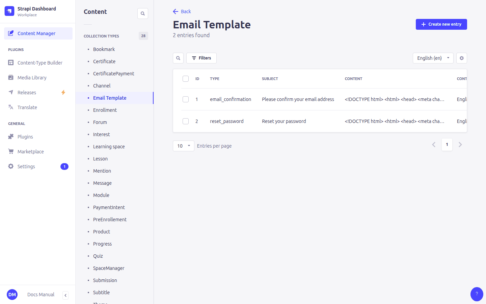
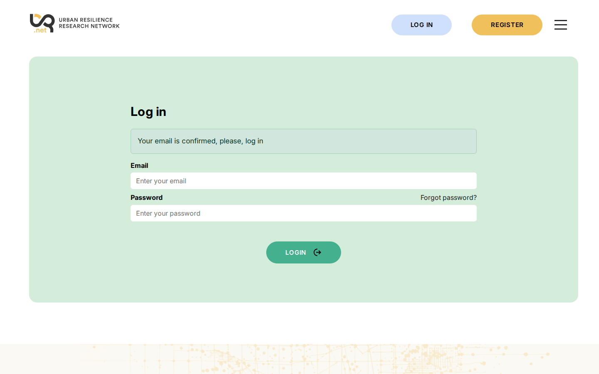

# 5. Emails

> Content types: **Email Template**, plus email fields in **Administration**, **Learning space** and **Product**

The platform sends these emails:

| Email | Sent to | Configured in |
|---|---|---|
| Confirm your email address (after registering) | The learner | **Email Template** `email_confirmation` |
| Reset your password (from *Forgot password?*) | The learner | **Email Template** `reset_password` + **Administration › Reset password front url** |
| New enrollment in *course* | Course team | **Learning space › Enrollment emails** |
| New payment for *product* (right after a payment) | Course team | **Product › Payment emails** |
| Summary of payments received in Stripe (every 10 minutes, when there are new ones) | Finance / admin | **Administration › Payment emails** |

All addresses fields take a **comma-separated** list: `ana@example.org, joan@example.org`.

## Email Template



| Field | Meaning |
|---|---|
| **type** | `email_confirmation` or `reset_password` |
| **subject** | The email subject |
| **content** | The email body, in **HTML** |

Each template is translated with the language selector, like any other entry. The learner receives the version in their language:

- confirmation: the language they used when registering;
- password reset: the language of the site when they requested it.

> ⚠️ Every enabled language needs **both** templates. If one is missing, the email is not sent and the learner gets an error.

### Placeholders

Write these in the **content** (not in the subject, where they are sent as typed); they are replaced when the email is sent:

| Placeholder | Replaced by |
|---|---|
| `{{NAME}}` | The learner's first name (or username/email if there is none) |
| `{{USER}}` | The learner's username (or email) |
| `{{EMAIL}}` | The learner's email address |
| `{{URL}}` | The confirmation or password-reset link |
| `{{LOGO}}` | The address of the **Administration › Logo** image, for `` |

Example content:

```html
<p></p>
<p>Hello {{NAME}},</p>
<p>To choose a new password, click <a href="{{URL}}">this link</a>.</p>
```

## Where the links go

- **Confirmation link**: it goes to the platform, which confirms the address and then redirects to the site's login page, where the learner sees an "email confirmed" message. The redirect address is set in **Settings › Users & Permissions plugin › Advanced settings › Redirection url** and should be `https://<site>/login?confirmed=1`.
- **Reset link**: **Administration › Reset password front url** followed by a code. It must end with `/reset?code=`.



## Who sends the emails

Emails go out from the address and mail server configured on the server (not in the admin panel). If no emails arrive at all, ask the technical team to check the SMTP settings.
