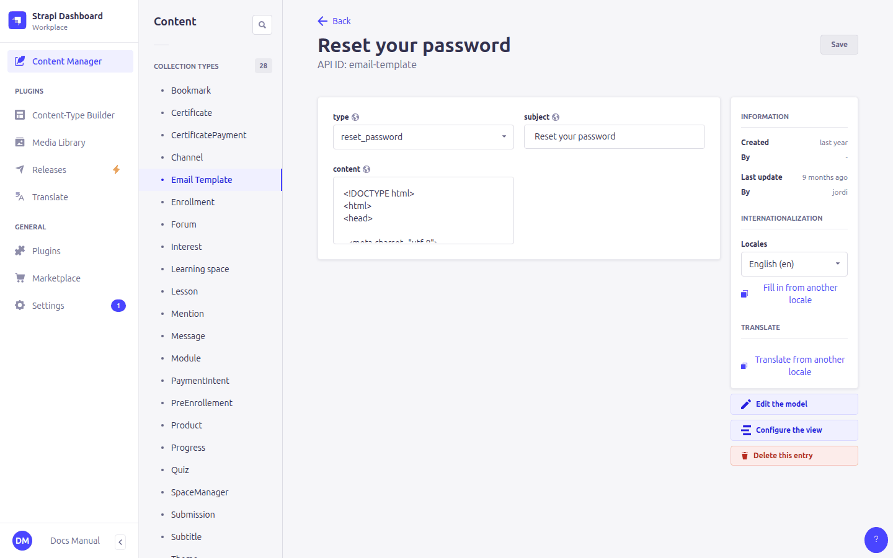

# 5. Emails

> Content types: **Email Template**, plus email fields in **Administration**, **Learning space** and **Product**

The platform sends these emails:

| Email | Sent to | Configured in |
|---|---|---|
| Confirm your email address (after registering) | The learner | **Email Template** `email_confirmation` |
| Reset your password (from *Forgot password?*) | The learner | **Email Template** `reset_password` + **Administration › Reset password front url** |
| New enrollment in *course* | Course team | **Learning space › Enrollment emails** |
| New payment for *product* (right after a payment) | Course team | **Product › Payment emails** |
| Summary of payments received in Stripe (every 10 minutes, when there are new ones) | Finance / admin | **Administration › Payment emails** |
| News: forum mentions, replies to the learner's messages, reviewed submissions | The learner | **Email Template** `notification_digest` (optional) |
| Announcement from a course manager | Learners enrolled in the course | **Email Template** `announcement` (optional) |
| Reminder to continue an unfinished course | The learner | **Learning space › reminderDays** + **Email Template** `course_reminder` (optional) |

All addresses fields take a **comma-separated** list: `ana@example.org, joan@example.org`.

## Email Template


| Field | Meaning |
|---|---|
| **type** | `email_confirmation` or `reset_password` |
| **subject** | The email subject |
| **content** | The email body, in **HTML** |



Each template is translated with the language selector, like any other entry. The learner receives the version in their language:

- confirmation: the language they used when registering;
- password reset: the language of the site when they requested it.

> ⚠️ Every enabled language needs **both** templates. If one is missing, the email is not sent and the learner gets an error.

### Placeholders

Write these in the **content** (not in the subject, where they are sent as typed); they are replaced when the email is sent:

| Placeholder | Replaced by |
|---|---|
| `{{NAME}}` | The learner's first name (or username/email if there is none) |
| `{{USER}}` | The learner's username (or email) |
| `{{EMAIL}}` | The learner's email address |
| `{{URL}}` | The confirmation or password-reset link |
| `{{LOGO}}` | The address of the **Administration › Logo** image, for `` |

Example content:

```html
<p></p>
<p>Hello {{NAME}},</p>
<p>To choose a new password, click <a href="{{URL}}">this link</a>.</p>
```

## Notifications

> Notification emails are **off** unless the server has `NOTIFICATIONS_ENABLED=true` (technical setting). While they are off, nothing is queued or sent, the *Announcements* tab and the *Email notifications* profile setting are hidden, and submission reviews are still saved and shown on the site.

Forum mentions, replies, reviews, announcements and reminders don't leave right away: they wait in a queue (**Content Manager › Notification**) and a task sends them every 5 minutes, after a delay of 15 minutes. Just before sending, each one is checked again, so nothing is sent if in the meantime:

- the message was deleted, or the mention removed from it, or the learner lost access to the channel;
- the feedback was removed from the submission;
- the announcement was cancelled, or the learner is no longer enrolled.

Mentions, replies and reviews for the same learner are grouped into one email. The Notification entry shows whether it was **sent**, **cancelled** (with the reason in **error**) or **failed**.

Learners can switch off the emails about mentions, replies and reminders in their profile (*Email notifications*). Reviews and announcements are always sent.

**Reminders**: set **reminderDays** on a course (e.g. `14`) to email learners who haven't finished it and haven't completed any page for that many days. Each learner gets one reminder per period of inactivity, and none after 4 × reminderDays (so old, abandoned enrollments aren't emailed). Reminders are prepared every day at 9:00. Leave reminderDays empty for no reminders.

The three new email types work without any Email Template: built-in texts in English, Catalan and Spanish are used. Create an Email Template of the type to change them. Placeholders: `{{NAME}}`, `{{SITE}}`, `{{LOGO}}`, `{{URL}}`, `{{FOOTER}}` (the "why you get this email" line with the settings link), and:

| Type | Extra placeholders |
|---|---|
| `notification_digest` | `{{ITEMS}}`: the list of news |
| `announcement` | `{{COURSE}}`, `{{SUBJECT}}`, `{{TEXT}}` |
| `course_reminder` | `{{COURSE}}`, `{{COMPLETED}}`, `{{TOTAL}}` |

**Missing languages**: for every email type, when there is no template in the learner's language the one in the site's default language is used, then the English one.

## Where the links go

- **Confirmation link**: it goes to the platform, which confirms the address and then redirects to the site's login page, where the learner sees an "email confirmed" message. The redirect address is set in **Settings › Users & Permissions plugin › Advanced settings › Redirection url** and should be `https://<site>/login?confirmed=1`.
- **Reset link**: **Administration › Reset password front url** followed by a code. It must end with `/reset?code=`.


## Who sends the emails

Emails go out from the address and mail server configured on the server (not in the admin panel). If no emails arrive at all, ask the technical team to check the SMTP settings.
