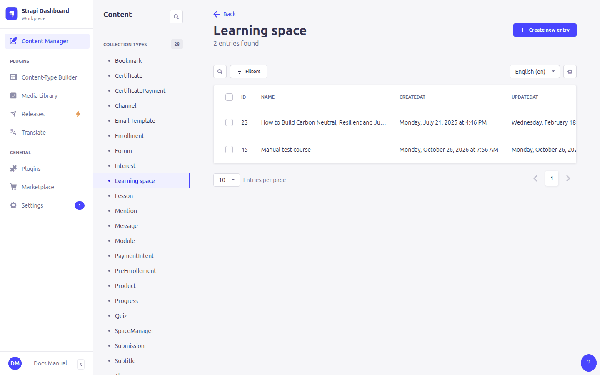
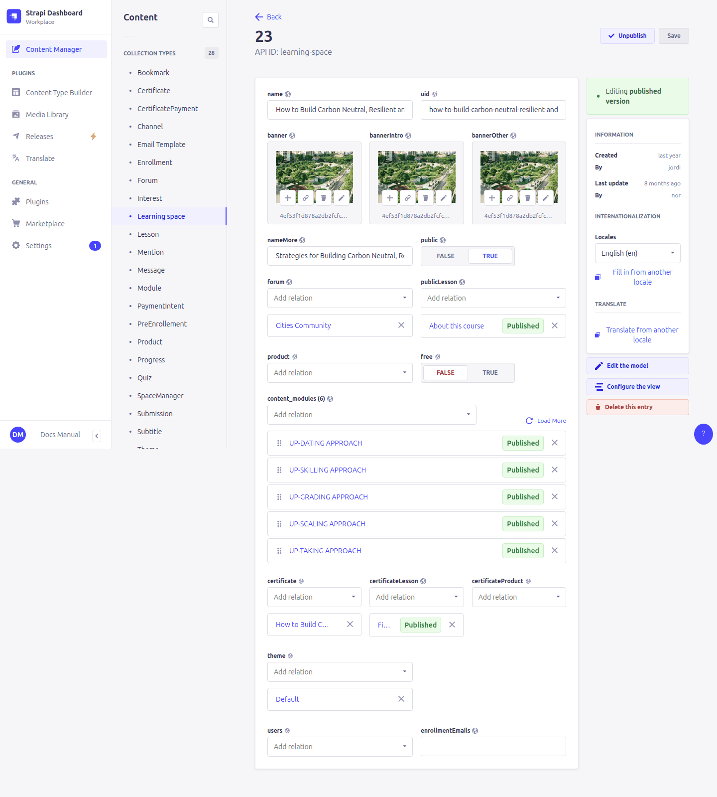
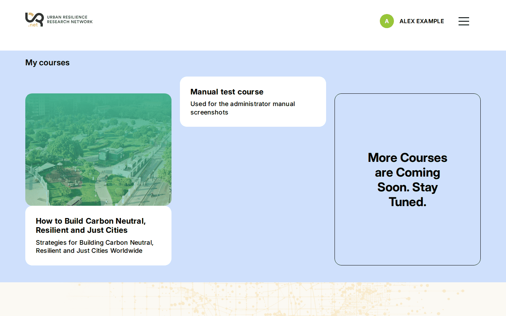
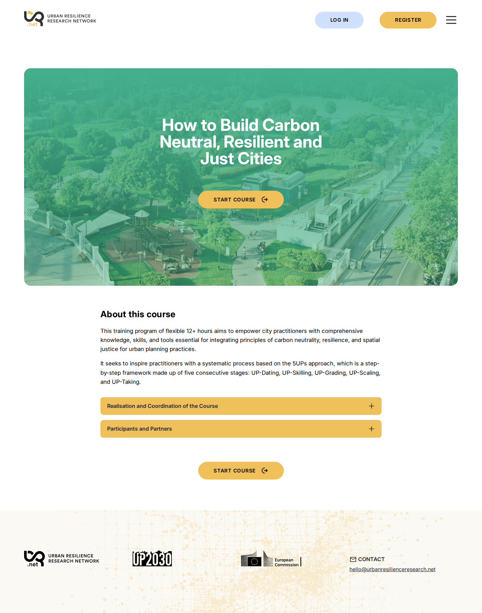
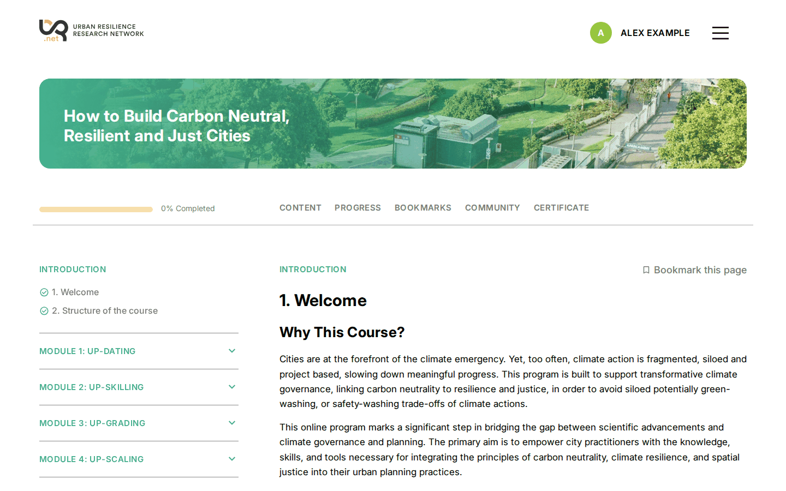
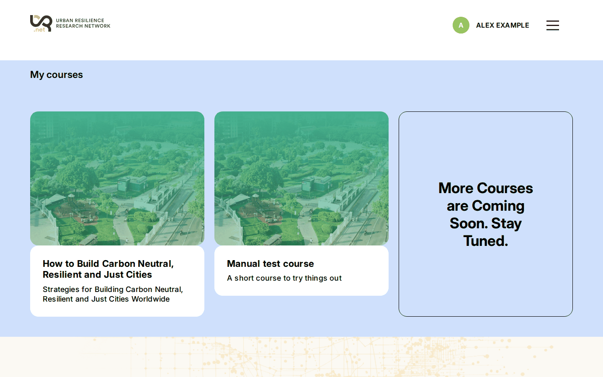
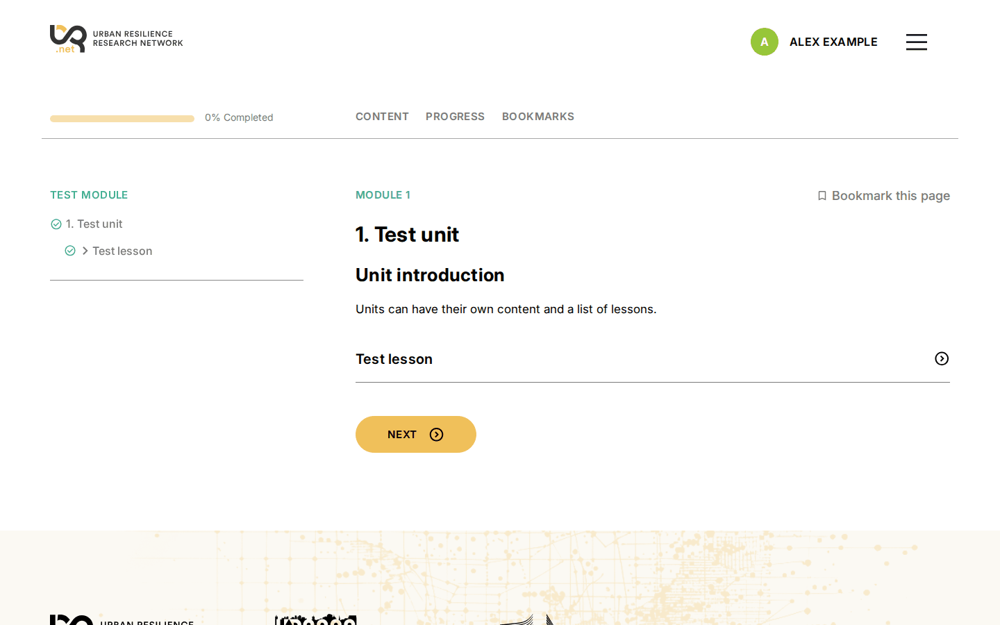
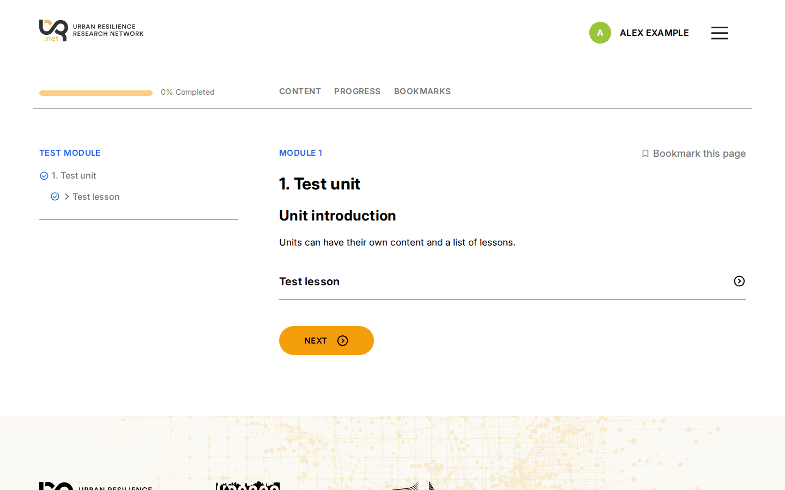

# 6. Courses (learning spaces)

> Content type: **Learning space** (translatable, draft/published)

A **learning space** is a course. It holds the course's name, images and descriptions, and links to everything else: its modules, forum, certificate, price and colour theme.

## Where each field appears

A course appears in three places on the site:

1. its **card** in the course catalogue (home page / dashboard),
2. its **landing page** (`/space/<uid>/about`), which anyone can open,
3. the **course pages** that enrolled learners use (`/space/<uid>/…`).

### 1. The catalogue card

| Field | On the card |
|---|---|
| **bannerOther** | The card image (about 5:4 works best). Without it the card shows only text. |
| **name** | The title. |
| **nameMore** | The subtitle under the title. |

Clicking the card opens the landing page.

### 2. The landing page

| Field | On the landing page |
|---|---|
| **bannerIntro** | The large image at the top, with the name, the *Free / Paid course* label and the main button (*Start course*, *Enroll*, *Pay*, or *Register* for visitors). **Without bannerIntro the whole top area, including the button, is not shown.** |
| **free** | Only chooses the label *free course* or *paid course*. It does not make a course free or paid; **Product** does. |
| **publicLesson** | A lesson shown as the page body (here: *About this course* with two accordions). Use it as a preview. Build it like any lesson ([7. Course structure](07-course-structure.md)), but don't add it to a unit, so it isn't part of the course itself. |
| **publicDescription** | A formatted description shown instead when there is **no** publicLesson. It is only shown to logged-in learners who aren't enrolled yet; visitors don't see it, so prefer publicLesson. |

### 3. The course pages

| Field | Inside the course |
|---|---|
| **banner** | The narrow banner with the course name at the top of every course page. Hidden if empty. |
| **content_modules** | The modules, in this order, in the left-hand menu. See [7. Course structure](07-course-structure.md). |
| **forum** | Adds the *Community* tab. See [9. Forum](09-forum.md). |
| **certificate** | Adds the *Certificate* tab. See [10. Certificates](10-certificates.md). |
| **certificateLesson** | A lesson shown on the certificate page, above the download button (e.g. explaining the requirements). |
| **certificateProduct** | Makes the certificate paid. See [11. Enrollment and payments](11-enrollment-payments.md). |
| **privateDescription** | A welcome text for enrolled learners. The site opens the first module automatically, so this text is rarely seen. |
| **theme** | A colour theme for this course only (see [below](#theme)). |

The tab bar under the banner shows *Content*, *Progress*, *Bookmarks*, *Community* (if there is a forum), *Certificate* (if there is a certificate) and *Admin* (for course managers, see [12](12-progress-managers.md)).

## Who can see a course

| Setting | Effect |
|---|---|
| **Published** | Unpublished (draft) courses don't exist for learners: no card, no landing page. |
| **public** | On: visitors and logged-in learners who aren't enrolled see the card in the catalogue (*All courses*). Off: the card is only shown to learners enrolled in the course. **The landing page still works** for anyone who has its address, so a course with *public* off can be shared by sending its link. |
| **product** | If set, learners must pay before enrolling. |
| **enrollmentEmails** | Addresses notified of every new enrollment (comma-separated). |
| **reminderDays** | Remind learners who stopped for this many days ([5. Emails](05-emails.md#notifications)). Empty: no reminders. |

A course doesn't need to be translated: when it has no version in the learner's language, the catalogue, the dashboard and the course pages show it in the site's default language, or else in the language it exists in.

Before enrolling, visitors and learners only receive the course's presentation (name, images, public description, public lesson, price) and its outline (module, unit and lesson titles). The content of units and lessons, the private description and the certificate lesson are only sent to enrolled learners and the course's managers.

## Example: changing the card and the theme

On the test course, filling in **nameMore** and the **bannerOther** image:

| Before | After |
|---|---|
|  |  |

And linking the **theme** "Test blue" to the test course: only that course's pages change colour; the rest of the site keeps the site theme.

| Before | After |
|---|---|
|  |  |

## Theme

A course **theme** is a **Theme** entry (see [3. Site settings and theme](03-site-settings.md#theme-colours)) linked from the course. It applies to the landing page and all the course pages, on top of the site theme, so it only needs the variables that should differ.

## Translating a course

Each language version of a course is edited separately, **including its relations**. Link the forum, certificate, products, theme, public lesson and modules in every language. The **default-language** version is the one the platform uses for enrolling, payments, completion and certificates, so it must always be complete. See [2. Working in the admin panel](02-admin-basics.md#languages-locales).

## Fields to ignore

- **uid**: see [2. Working in the admin panel](02-admin-basics.md#the-uid-field).
