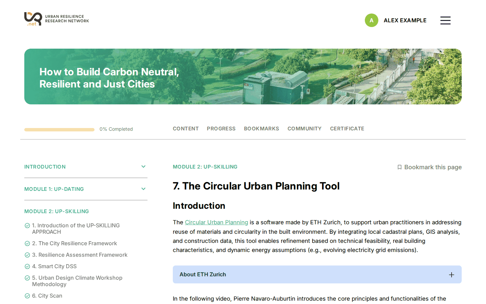
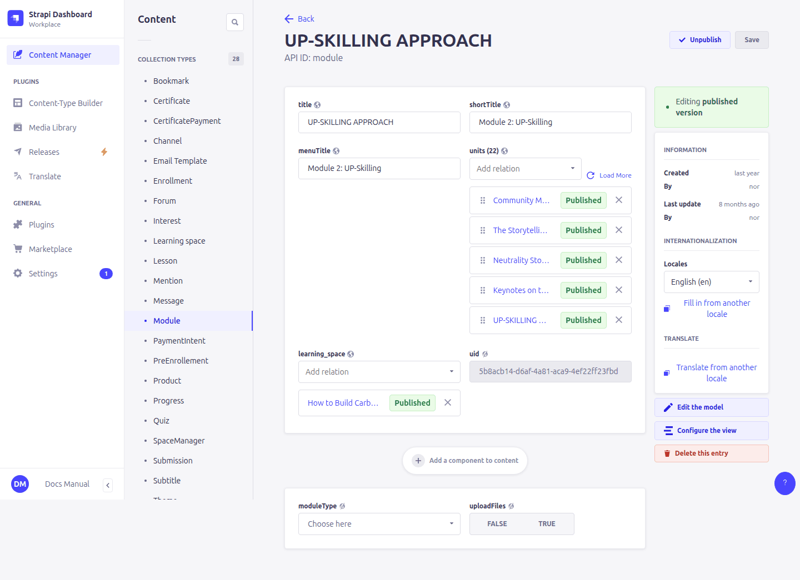
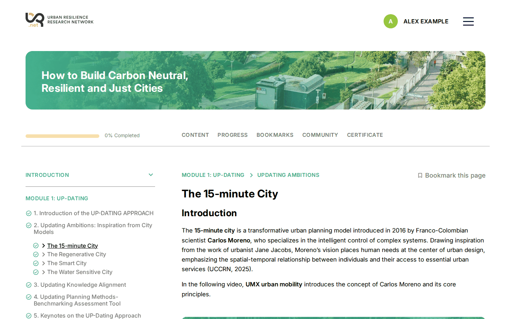
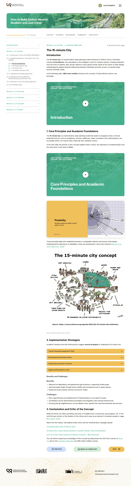
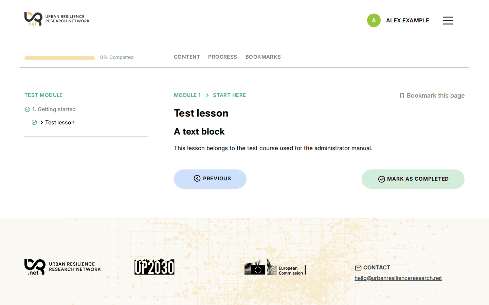

# 7. Course structure: modules, units and lessons

> Content types: **Module**, **Unit**, **Lesson** (all translatable, draft/published)

```
Learning space ─ content_modules ─▶ Module ─ units ─▶ Unit ─ lessons ─▶ Lesson
```

- A **module** is an entry in the course's left-hand menu.
- A **unit** is a page inside a module. It can have its own content and a list of lessons.
- A **lesson** is a page inside a unit.

Learners move through them in order with *Previous* / *Next*, and mark each page as completed.



## Building a course, step by step

1. Create the **lessons** (title + content blocks).
2. Create the **units**: title, content blocks, and the lessons in **lessons**, in order.
3. Create the **modules**: the three titles, and the units in **units**, in order.
4. Open the **learning space** and add the modules to **content_modules**, in order.
5. **Publish** lessons, units, modules and the course.

You can also work the other way round: the relation fields on the right of each form (**module** on a unit, **unit** on a lesson) set the same link from the other side.

The **order** of modules, units and lessons is the order in the relation list. Drag the items in the list to change it.



## Module

| Field | Where it appears |
|---|---|
| **menuTitle** | The entry in the left-hand menu. A check mark appears when the learner completes the module. |
| **shortTitle** | The small uppercase heading above the page content, e.g. `MODULE 1 › UNIT 2`. |
| **title** | The *Progress* and *Bookmarks* pages and the managers' statistics. |
| **units** | The module's units, in order. |
| **moduleType** | **Content** (normal) or **Monitoring** (see below). |
| **uploadFiles** | Shows a file upload box on the module's pages so learners can hand in work. See [12. Following learners](12-progress-managers.md#submissions). |
| **content** | Not shown on the site. Put introductory content in the first unit instead. |



### Monitoring modules

A **Monitoring** module is for follow-up activities (e.g. uploading evidence) rather than reading. Its lesson-less units have no *Mark as completed* button and the module doesn't count in the completion percentage.

> ⚠️ A Monitoring module with lesson-less units still counts as *pending* for the certificate, so learners can never get it. Don't combine Monitoring modules with a certificate. See [14. Known limitations](14-known-limitations.md).

## Unit

| Field | Where it appears |
|---|---|
| **title** | In the menu under the open module, as the page heading (`2. Title`), on *Progress*, *Bookmarks* and the *Previous / Next* buttons. |
| **shortTitle** | In the small heading when one of its lessons is open: `MODULE › UNIT`. |
| **content** | The page's content blocks ([8. Content blocks](08-content-blocks.md)), followed by links to its lessons. |
| **lessons** | Its lessons, in order. |
| **menuTitle** | Not used. |

**Completion:**

- A unit **with lessons** is completed when all its lessons are completed. It has no button of its own.
- A unit **without lessons** has its own *Mark as completed* button.

## Lesson

| Field | Where it appears |
|---|---|
| **title** | In the menu, as the page heading, on *Progress* and *Bookmarks*. |
| **content** | The page's content blocks, with *Previous*, *Mark as completed* and *Next* buttons. |
| **unit** | The unit it belongs to. |
| **shortTitle** | Not used. |



A lesson that isn't in any unit doesn't appear in the course. That's how the **public lesson** and the **certificate lesson** of a course are built ([6. Courses](06-learning-spaces.md)).

## Example: renaming a unit

On the test course, changing a unit's **title** and **shortTitle**:

| Before | After |
|---|---|
|  |  |

## Hiding or removing content

- To hide a module, unit or lesson, **remove it from its parent's list** (or delete it). Unpublishing it is not enough inside a published course.
- Never change the **uid** of a module, unit or lesson in use: learners' progress and bookmarks are linked to it.
