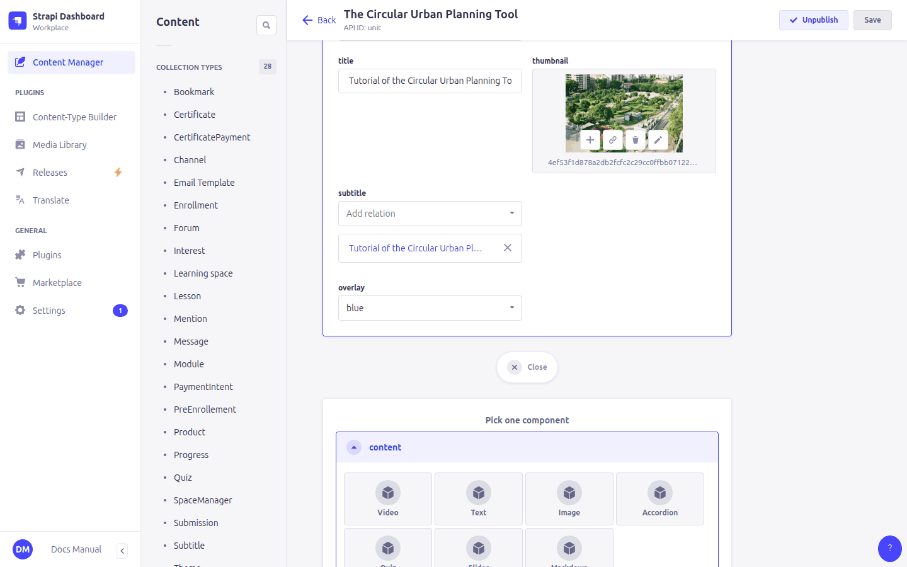
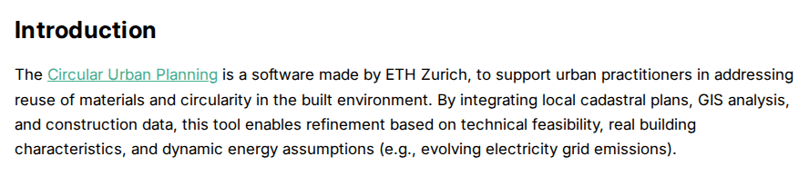
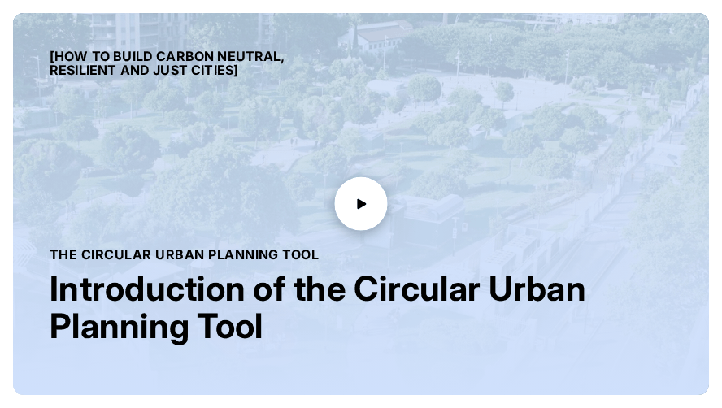
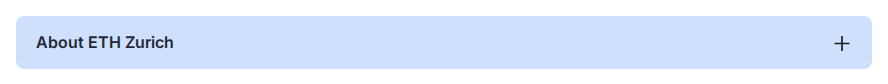
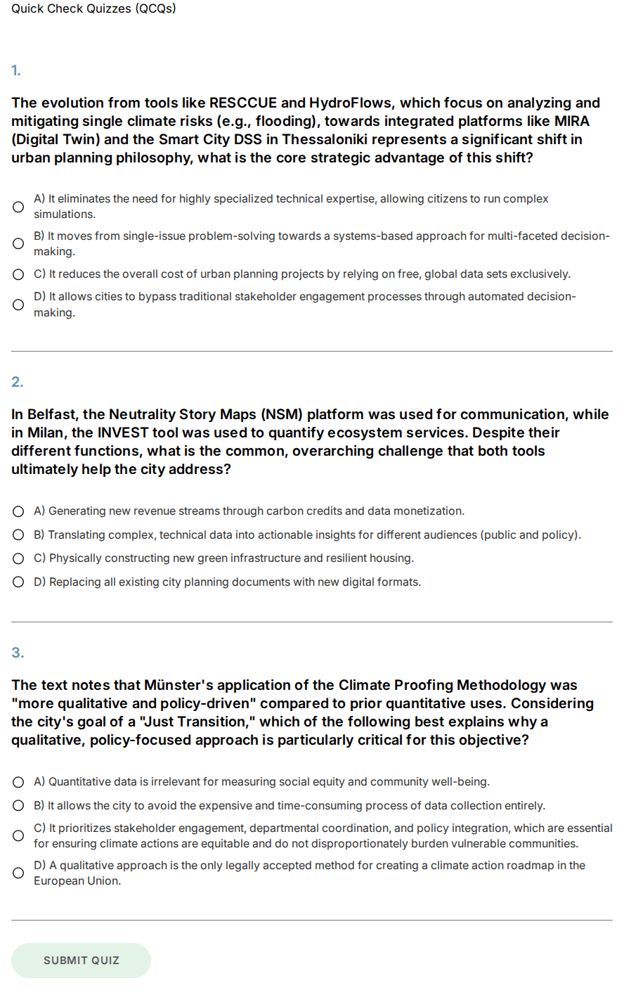

# 8. Content blocks

> Components in the **content** field of **Unit** and **Lesson**; content types **Quiz** and **Subtitle**

Unit and lesson pages are built from **blocks**. In the **content** field click **Add a component to content**, choose the block type, fill it in, and drag the blocks to put them in order.



| Block | Use it for |
|---|---|
| [Text](#text) | Formatted text with headings, lists, links |
| [Markdown](#markdown) | Text written in Markdown or HTML |
| [Image](#image) | A picture with caption |
| [Video](#video) | A video with thumbnail, subtitles and transcript |
| [Accordion](#accordion) | Collapsible sections |
| [Slider](#slider) | A carousel of slides |
| [Quiz](#quiz) | Multiple-choice questions |

## Text

| Field | On the page |
|---|---|
| **title** | Heading above the text (optional) |
| **text** | The rich-text editor: paragraphs, headings, bold/italic, lists, quotes, code, links (they open in a new tab) |



## Markdown

| Field | On the page |
|---|---|
| **title** | Heading (optional) |
| **text** | Markdown, which may include HTML. Links to files in the media library (`/uploads/…`) work as they are. |

Most of the Balkar content migrated in October 2026 uses this block. For new content the **Text** block is easier.

## Image

| Field | On the page |
|---|---|
| **image** | The picture |
| **caption** | Text under the picture. If empty, the caption from the media library is used. |
| **alternativeText** | Description for screen readers. If empty, the one from the media library is used. |
| **cssClass** | Optional styling. `certificate-image` shows the picture as a white framed card with a shadow. |

## Video



| Field | On the page |
|---|---|
| **thumbnail** | The image shown before playing, with the course name, the unit title and the video **title** on top. |
| **overlay** | The colour tint over the thumbnail: **green** (theme primary colour, default), **yellow** (theme secondary colour) or **blue** (theme light accent colour, with dark text). |
| **video** | An uploaded video file. |
| **url** | Used when *video* is empty: the **embed** address of a hosted video, e.g. `https://www.youtube.com/embed/VIDEO_ID` or `https://player.vimeo.com/video/123456`. A normal YouTube page address does not work. |
| **subtitle** | A **Subtitle** entry with the subtitles in one or more languages (see below). |
| **transcript** | Not used. The transcript comes from the **Subtitle** entry. |

### Subtitles and transcripts

> Content type: **Subtitle** (translatable)

| Field | Meaning |
|---|---|
| **name** | A name to find it in the list (also used in the transcript file name). |
| **text** | The subtitles in **WebVTT** format, pasted as text (starts with `WEBVTT`). |
| **transcript** | The plain-text transcript that learners can download. |

Create one Subtitle entry and add each language as a localization of it. Link the entry from the video block. The player then offers every language. The learner's site language is selected by default, and the *Download transcript* button appears once the video plays.

```
WEBVTT

00:00:01.000 --> 00:00:04.000
Welcome to the course.
```

## Accordion

| Field | On the page |
|---|---|
| **items** | Each has a **title** (always visible) and a **text** (shown when opened). One item opens at a time. |
| **color** | **primary**, **secondary**, **tertiary** (default) or **loop** (each item in turn: tertiary, primary, secondary). The colours come from the theme. |



## Slider

| Field | On the page |
|---|---|
| **title** | Shown on every slide. |
| **items** | The slides. Each has **preTitle**, **title**, **text**, a background **image** with **imageSize** (*cover* fills the slide, *contain* shows the whole image, *initial* uses its real size), a **logo** on top, and its own **color**. |
| **color** | Same as accordion. With **loop**, a slide's own *color* overrides its turn. |

## Quiz

> Content type: **Quiz** (translatable, draft/published), inserted with the **Quiz** block

| Field | On the page |
|---|---|
| **introduction** | Text above the questions. |
| **questions** | Each question has a **title** (`1. Title`), the **question** text, the **options** (each with a tick for **correct**) and an **answer**: the explanation shown after the learner submits. |
| **minToPass** | The **percentage** of correct answers needed to pass (e.g. `70`). Empty = all answers must be correct. |
| **title** | Only to find the quiz in the admin list. Not shown on the site. |



While a quiz on a page isn't passed, the *Mark as completed* button stays disabled. Answers are **not saved**: the platform only records that the page was completed.
