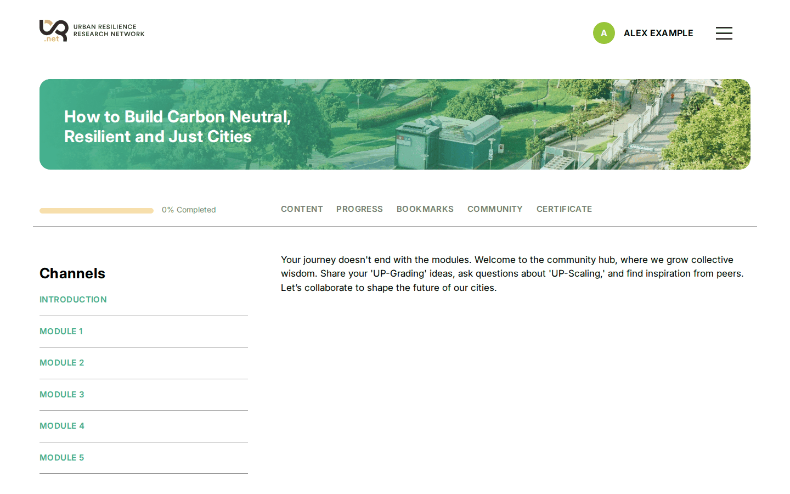
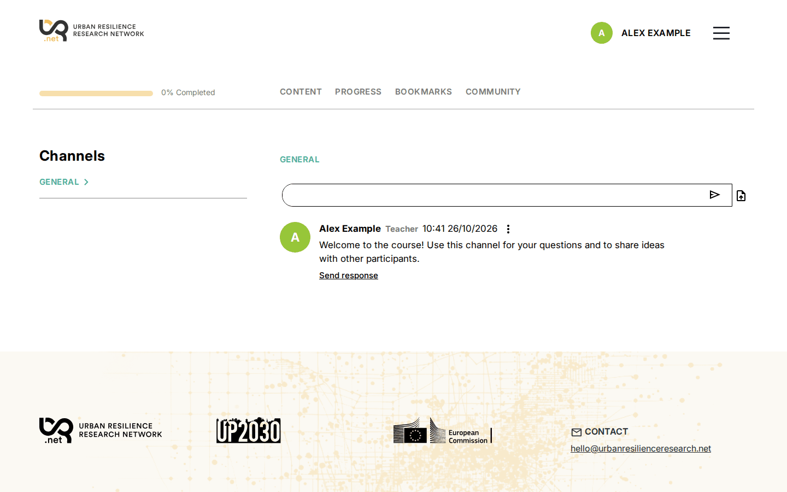
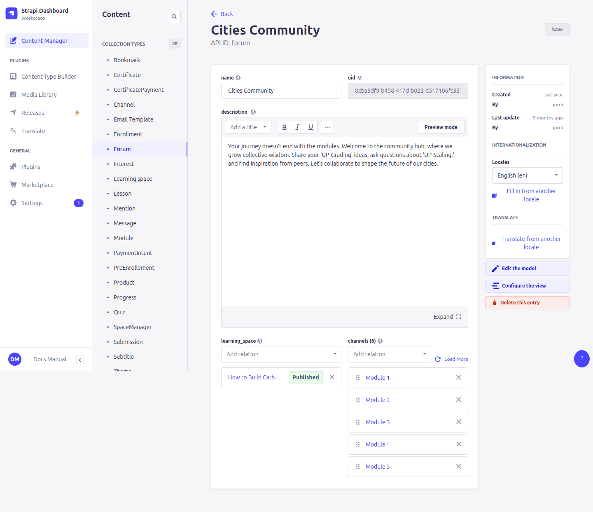
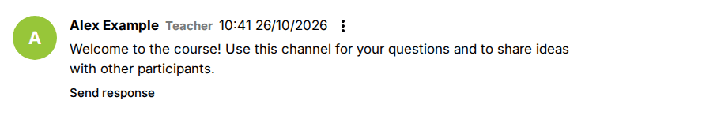

# 9. Forum

> Content types: **Forum**, **Channel** (translatable); **Message** (written by learners)

A course can have a **forum**, shown as the *Community* tab. A forum is divided into **channels** (topics). Learners write messages, reply to them, attach files and mention other learners with `@`.

Inside a channel, learners write at the top and the messages appear below, newest first, each with *Send response* for replies:

## Setting up a forum

1. Create a **Forum**: **name**, **description** (shown at the top of the forum page) and **learning_space**.
2. Create its **Channels**: **name**, **order** (lower numbers first) and **forum**.
3. Open the course and check that **forum** points to the new forum.
4. Repeat for every language of the course (see below).

### Languages

Each language version of a course links its **own** forum, and each forum its own channels. Create the other languages as **localizations** of the forum and of each channel (language selector). A channel and its translations share the same uid, so **learners of all languages read and write the same conversation**. Only the channel names and forum description change with the language.

## Public and restricted channels

| Channel's **users** field | Who sees the channel |
|---|---|
| Empty | Every learner enrolled in the course (*public channel*) |
| Some learners selected | Only those learners. Use it for working groups. |

Learners get unread-message counters only for channels where they are listed by name.

## Teachers

Messages written by an account with **manager** ticked (in **User**) show a **Teacher** badge. See [12. Following learners](12-progress-managers.md#course-managers).

## Moderating

Messages are in **Content Manager › Message**: author, channel, text, attached file, and the parent message if it is a reply. To remove an inappropriate message, delete it there. Check its replies (the **children** field) too.

The **Mention** and **User Channel Read** content types are filled by the platform (or no longer used). You don't need to touch them.
