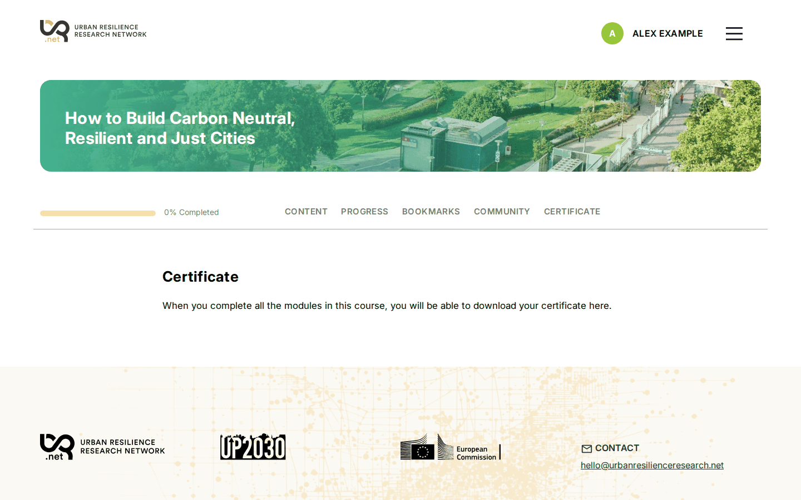
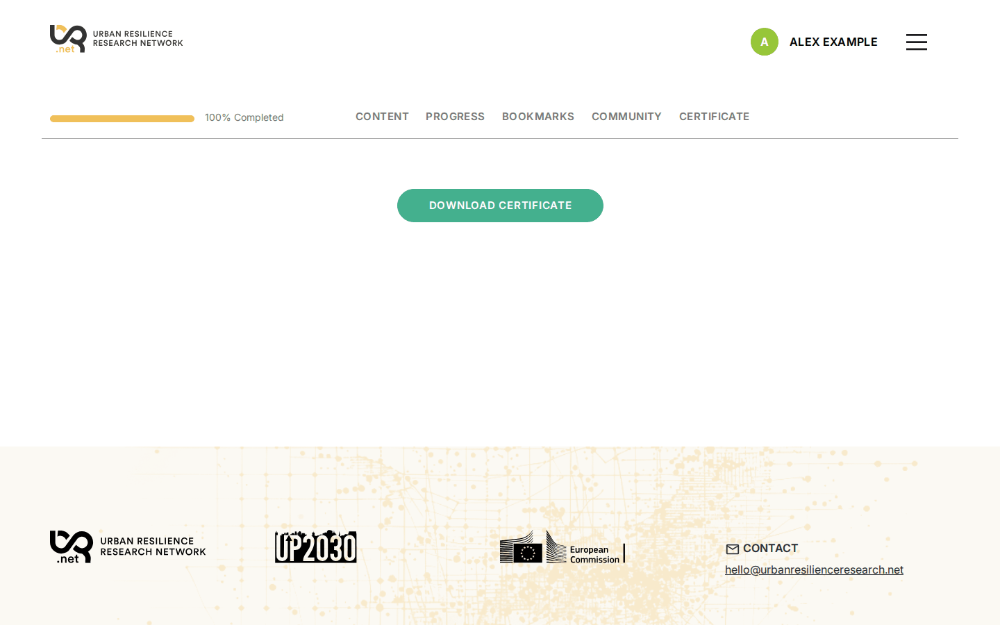
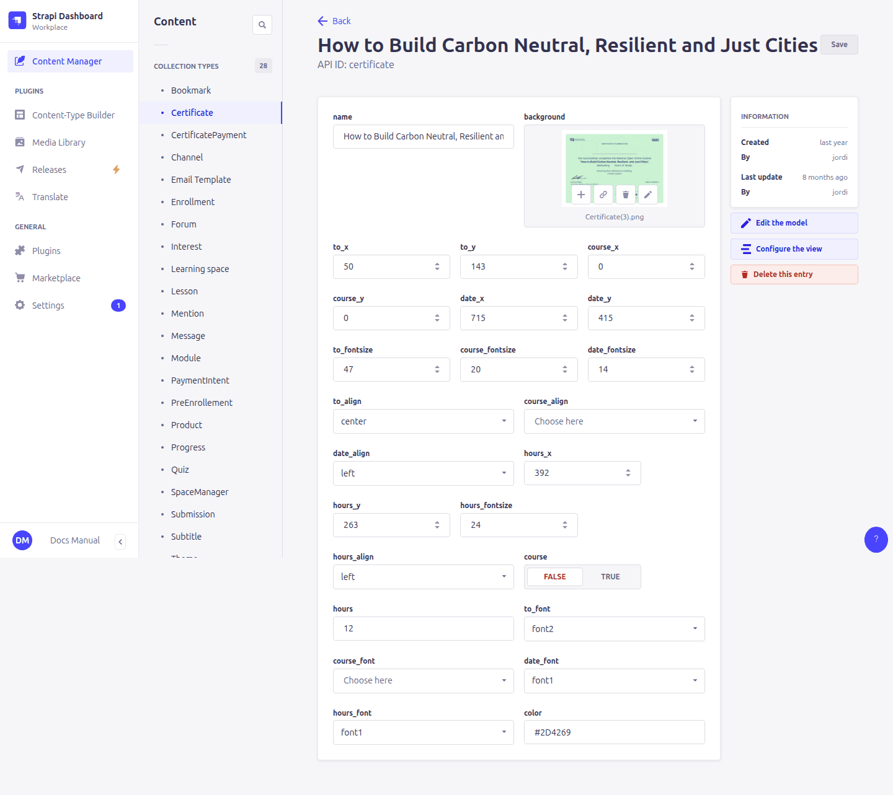
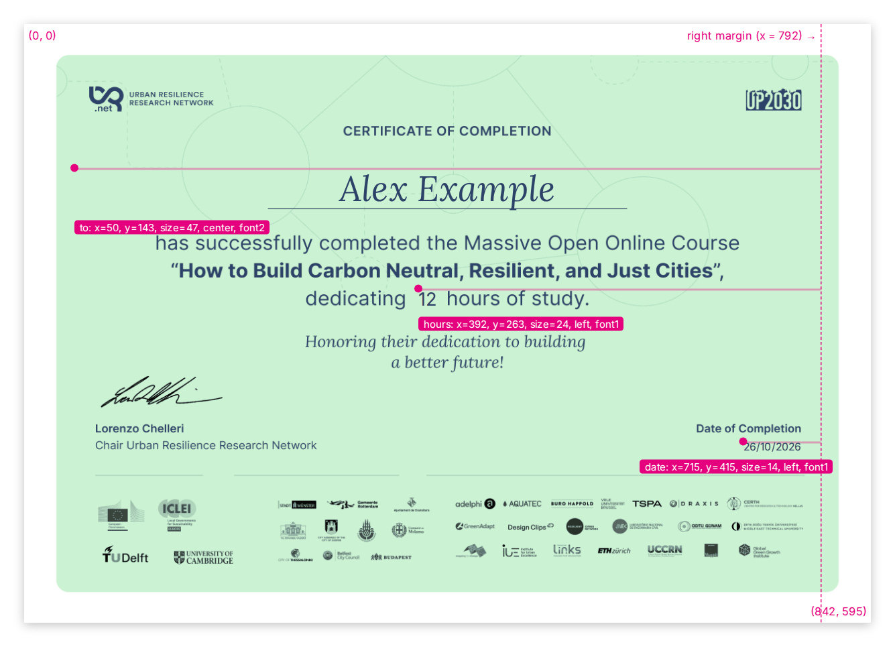
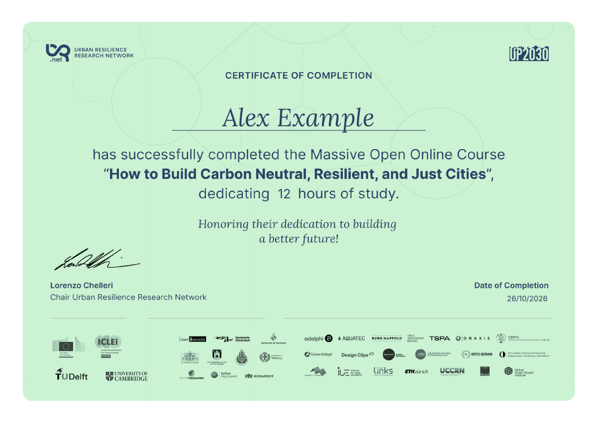

# 10. Certificates

> Content types: **Certificate** (the design), **UserCertificate** (issued certificates), **CertificatePayment**

A course with a **certificate** gets a *Certificate* tab. When a learner has completed **every** lesson (and every unit without lessons), the tab offers a **Download** button that creates a PDF with their name.

Once everything is completed, the page offers the download:

The text on that page above the button is the course's **certificateLesson** ([6. Courses](06-learning-spaces.md)). Use it to explain the requirements. Until the course is completed, the page shows the `certificate-explanation-not-completed` text ([4. Interface texts](04-translations.md)).

## Designing the certificate

The PDF is an **A4 landscape** page (**842 × 595 points**, origin at the **top-left** corner). The **background** image fills the whole page; prepare it at that proportion (e.g. 3508 × 2480 px) with everything that doesn't change: logos, borders, signatures, fixed texts.

On top of it the platform writes up to four texts:

| Text | Fields | Content |
|---|---|---|
| Recipient | `to_x`, `to_y`, `to_fontsize`, `to_align`, `to_font` | The learner's **name** and **last name** |
| Course | `course_x`, `course_y`, `course_fontsize`, `course_align`, `course_font` | The course **name** (default language). Only if **course** is ticked. |
| Date | `date_x`, `date_y`, `date_fontsize`, `date_align`, `date_font` | The issue date, `dd/mm/yyyy` |
| Hours | `hours_x`, `hours_y`, `hours_fontsize`, `hours_align`, `hours_font` | The **hours** field as written (e.g. `12 hours`). Only if it is filled in. |

For each text:

- **x / y**: position in points from the left / top edge.
- **fontsize**: size in pixels (defaults: 30 recipient, 20 course, 15 date and hours).
- **align**: `left`, `center` or `right`, within the space from *x* to the right margin (50 points from the right edge). **To centre a text on the page, set x to 50 and align to center.** Long texts wrap onto a new line at the right margin.
- **font**: `font1` = Inter (sans-serif), `font2` = Lora italic.

**color** sets the colour of all texts, as a hex code (`#020034`). Default is black.

And the PDF a learner downloads with these settings:

## Testing a design

> ⚠️ A learner's PDF is created **once**, the first time they download it, and kept. Later changes to the design, or to the learner's name, don't change certificates already issued.

To check a new design:

1. use a test account that has completed the course, download the certificate and look at it;
2. to try again, delete that account's entry in **UserCertificate**: the next download creates a new PDF with the current design.

The same applies when a learner asks to correct their name: fix it in **User**, delete their **UserCertificate** entry for the course, and ask them to download it again.

## Issued certificates

**Content Manager › UserCertificate** lists every certificate issued: learner, course, date, the name printed on it and the file name. The PDF itself is at `https://<api address>/certificates/<filename>.pdf`.

## Paid certificates

If the course has a **certificateProduct**, the certificate page shows a *Pay* button first. After paying, a **CertificatePayment** entry (email + course uid) is created and the download is unlocked. To give a certificate for free to someone, create a CertificatePayment yourself with their **email**, the course **uid** and **payment** ticked. See [11. Enrollment and payments](11-enrollment-payments.md).
