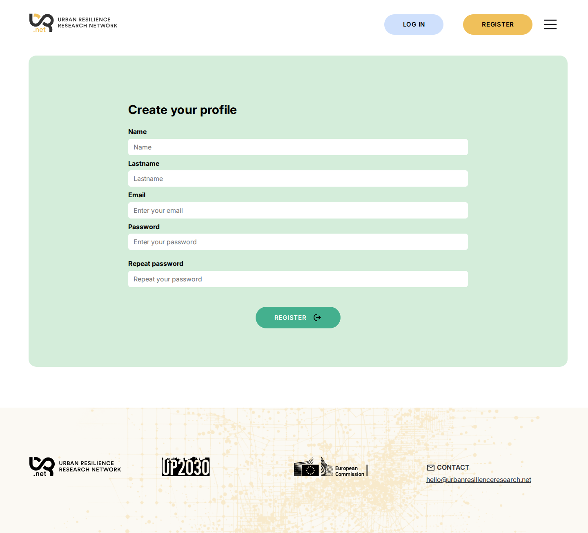
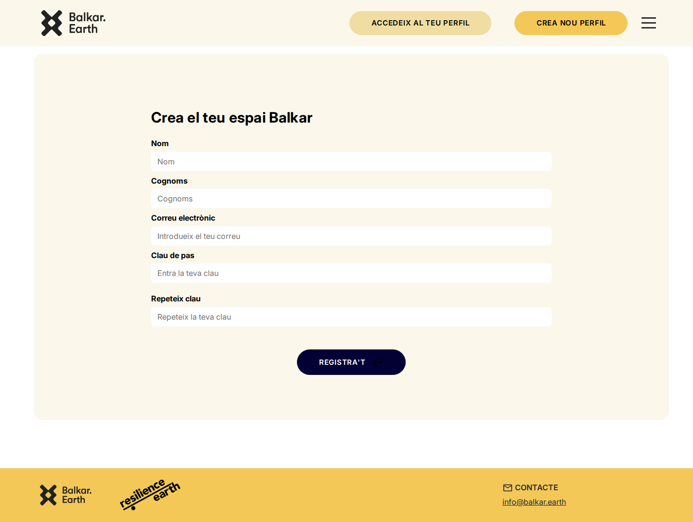
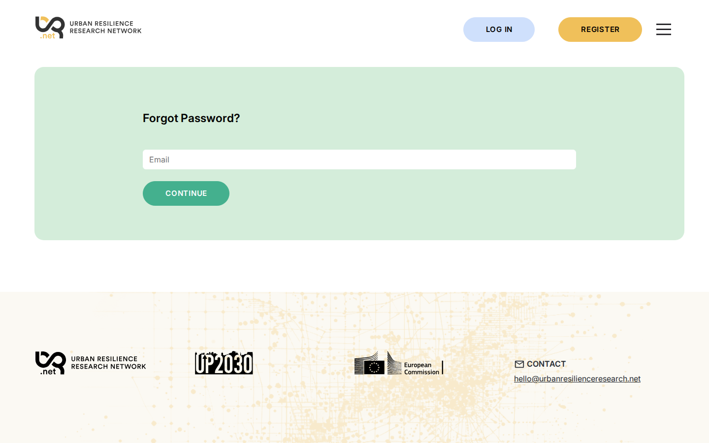
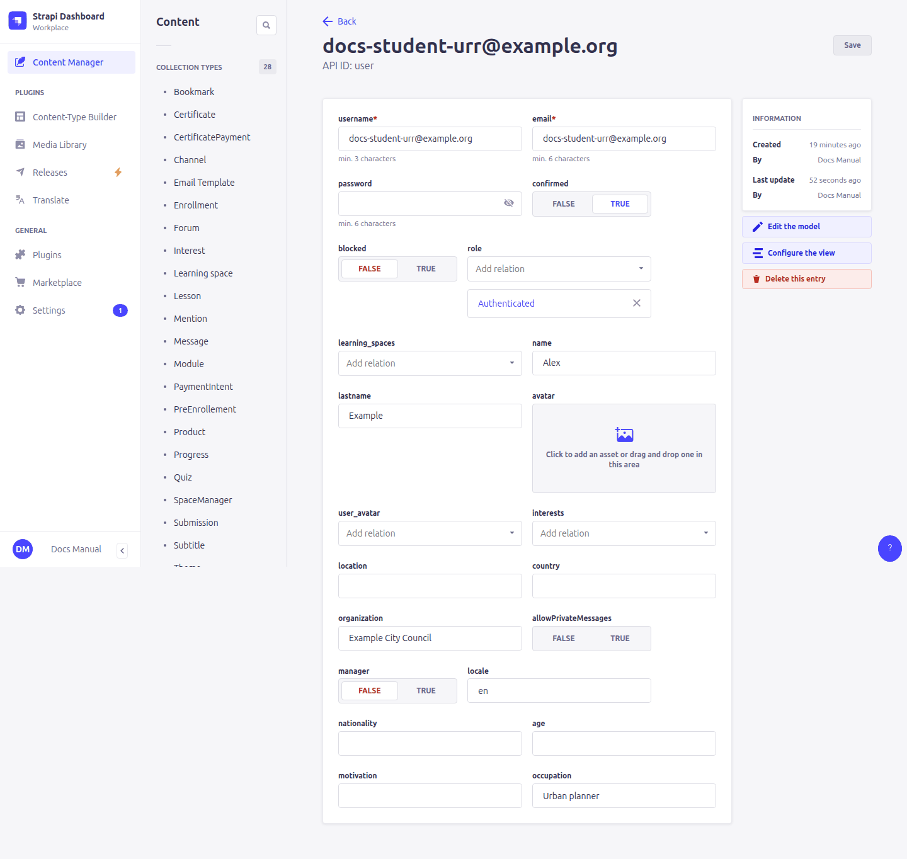
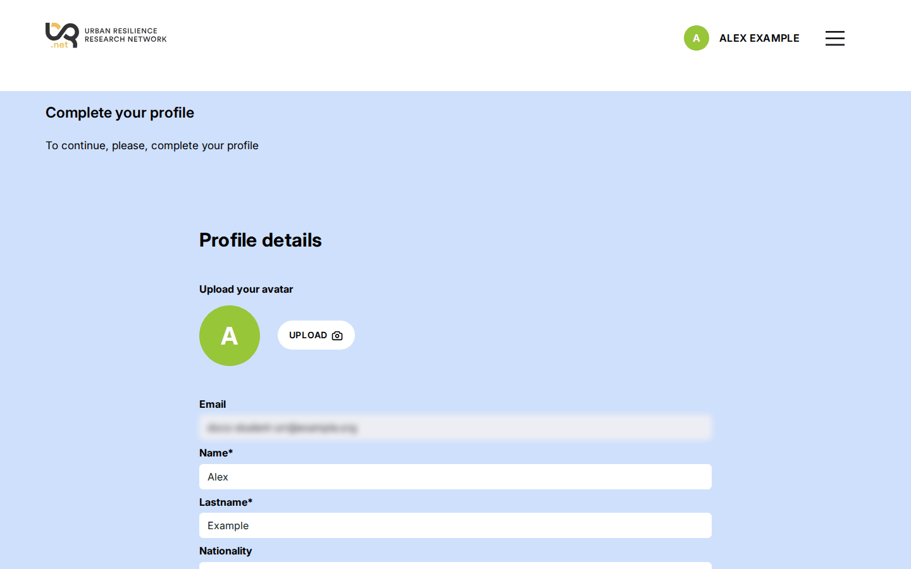
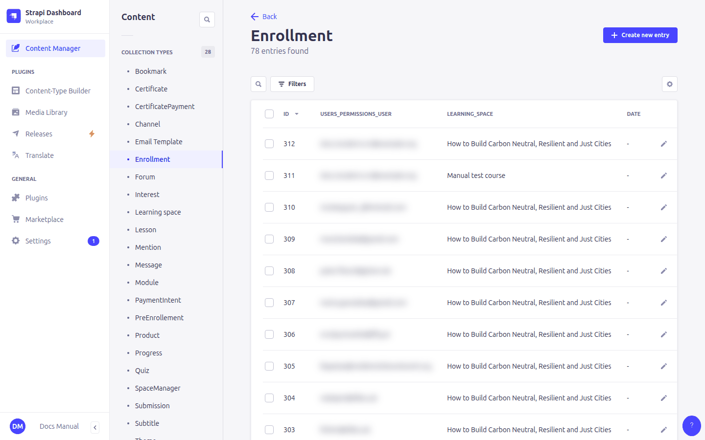

# 11. Learners, enrollment and payments

> Content types: **User**, **Enrollment**, **PreEnrollement**, **Product**, **PaymentIntent**, **CertificatePayment**, **UserAvatar**, **Interest**

## Learner accounts

Learners create their own account with **Register** (first name, last name, email, password). They receive a confirmation email ([5. Emails](05-emails.md)) and must click its link before they can log in. (This is the **Enable email confirmation** option in **Settings › Users & Permissions plugin › Advanced settings**.)

*Forgot password?* on the login page sends a reset link:

### The User entry

Accounts are in **Content Manager › User**.

| Field | Meaning |
|---|---|
| **name**, **lastname** | Shown in the header and the forum, and printed on the certificate. |
| **email**, **username** | Login (by email). |
| **confirmed** | Ticked once the learner clicked the confirmation link. Tick it yourself if the email never arrived. |
| **blocked** | Prevents the learner from logging in. |
| **locale** | The language of their emails. Updated when they change language on the site. |
| **manager** | Makes the account a **teacher / course manager** ([12](12-progress-managers.md#course-managers)). |
| **organization**, **occupation**, **nationality**, **age**, **motivation** | Filled in by the learner in their profile. |
| **role** | Leave it as **Authenticated**. |
| location, country, interests, allowPrivateMessages, avatar, learning_spaces | Not used at the moment. |

The **first time** a learner logs in, the dashboard asks them to complete their profile before showing the courses:

Profile pictures are stored in **UserAvatar** (one per learner). The **Interest** list is not used at the moment.

## Enrolling in a course

An **Enrollment** links a learner to a course. It is what opens the course pages, the forum and the certificate to them.

- **Free course** (no **product**): the learner clicks *Enroll* on the landing page.
- **Paid course**: the learner pays first (see below), then enrolls.

Every new enrollment emails the course's **enrollmentEmails** addresses.

### Enrolling someone yourself

There are two ways, both of which work for paid courses too:

- **The learner already has an account:** create an **Enrollment** with the **user** and the **learning space** (default-language version).
- **The learner has no account yet** (e.g. a group you invite): create a **PreEnrollement** with their **email** and the course **uid**. For a **paid** course, also tick **payment**: otherwise it is ignored. When they register (or log in) with that email, the platform turns it into an enrollment automatically and deletes the PreEnrollement.

When someone registers from the landing page of a **free** course, the platform creates a PreEnrollement for that course by itself, so they are enrolled as soon as they log in. For paid courses, only a payment (or an admin ticking **payment**) creates one that counts.

### Removing someone from a course

Delete their **Enrollment** for that course. Their progress is kept and comes back if they enroll again.

## Paid courses and Stripe

> Content type: **Product** (draft/published)

Payments go through **Stripe**. A **Product** is a price:

| Field | Meaning |
|---|---|
| **name**, **description**, **image** | Shown on the Stripe payment page. |
| **price** | In euros, e.g. `49.00`. |
| **paymentEmails** | Addresses notified right after each payment. |
| **stripeProductId**, **stripePriceId** | **Filled in automatically** when you save the product. Don't edit them. |

When you **create** a product, the platform creates it in Stripe. When you **change** its name, description, image or price, it updates Stripe; a new price applies to new payments only. After changing a price, check in the Stripe dashboard that the new price is there.

To make a course paid, link the product in the course's **product** field, in **every language** of the course. For a paid certificate use **certificateProduct** instead ([10. Certificates](10-certificates.md)).

### What happens when a learner pays

1. On the landing page the learner clicks *Pay*. Stripe's payment page opens.
2. After paying, Stripe sends them back to the site. A **PreEnrollement** with *payment* ticked is created for their email, and the product's **paymentEmails** are notified.
3. If they are logged in they click *Enroll*. If not, they register with the same email and are enrolled automatically.

**PaymentIntent** entries are the platform's record of Stripe events. Every 10 minutes, new payments received from Stripe are summarised in an email to **Administration › Payment emails**. You don't need to edit these entries. Their **state** is *intent* (payment page opened), *received* (payment received), *handled* (included in a summary email) or *error*.

> ⚠️ If a learner paid with one email address and registered with another, the platform can't match them. Create a PreEnrollement with the email of their account, the course uid and **payment** ticked.
