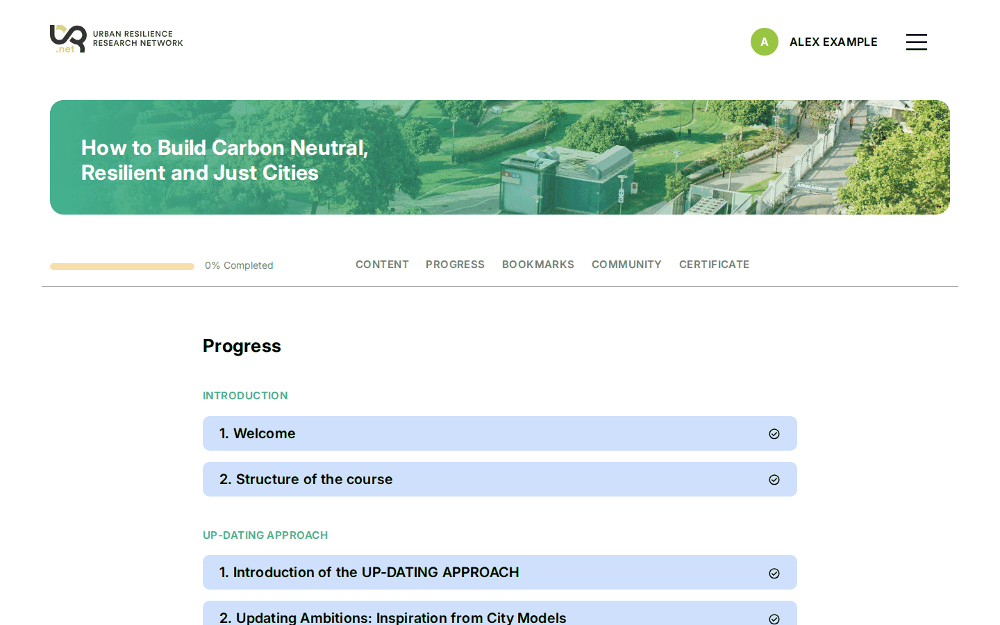
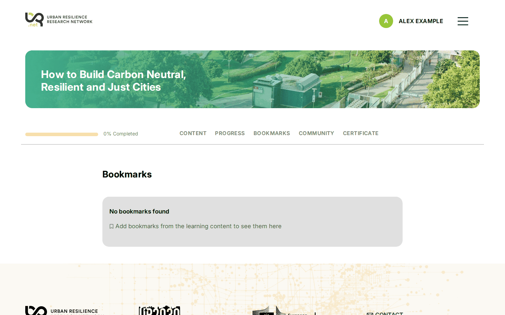
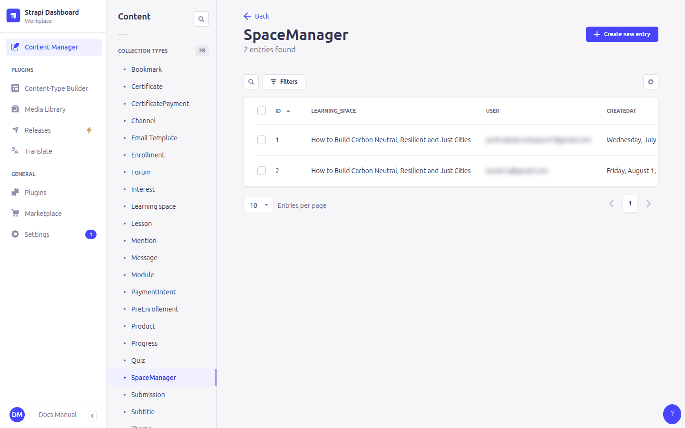
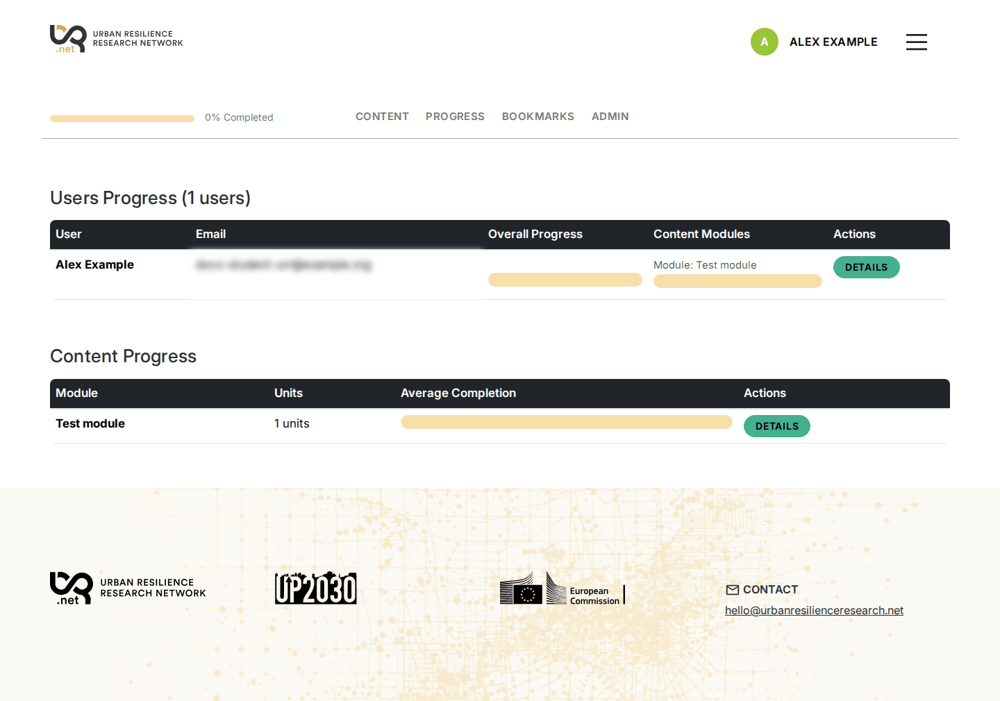
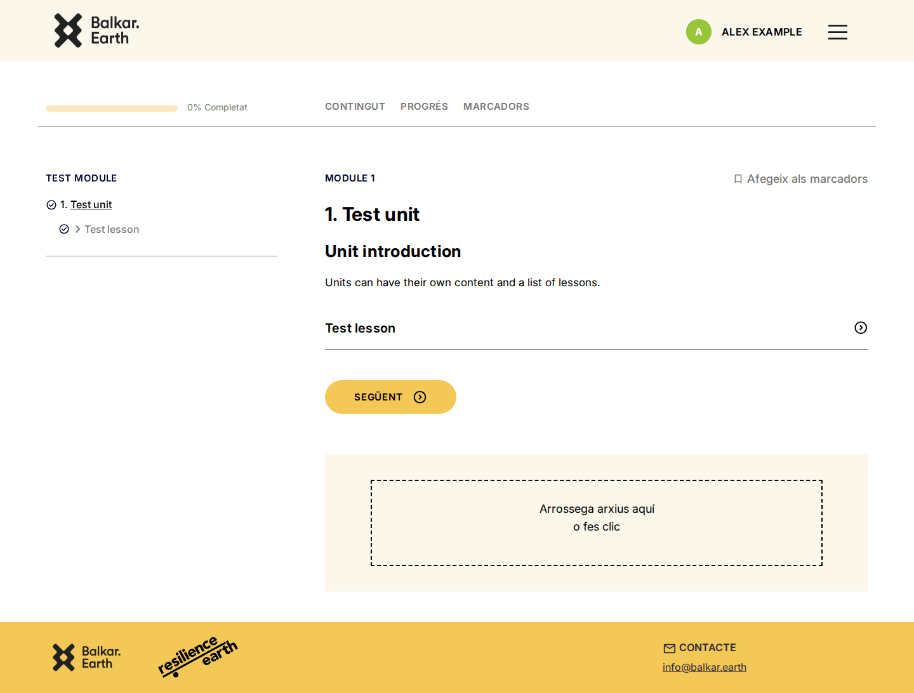

# 12. Following learners: progress, managers and uploads

> Content types: **Progress**, **Bookmark**, **Submission**, **SpaceManager**

## What learners see

Each time a learner clicks *Mark as completed*, a **Progress** entry is saved. The platform uses these entries for:

- the progress bar under the course banner and the check marks in the menu,
- the **Progress** tab, listing every module, unit and lesson with its status,
- unlocking the **certificate** when everything is completed.

With *Bookmark this page* learners save pages to find them later in the **Bookmarks** tab (**Bookmark** entries).

You don't need to create or edit Progress or Bookmark entries. If a learner completed a page by mistake, they can click *Mark as not completed* themselves.

## Course managers

A **course manager** (teacher, tutor) is a learner account that also sees the course's statistics in an extra **Admin** tab. It needs three things:

1. In **User**, tick **manager** on their account.
2. Create a **SpaceManager** entry with that **user** and the **learning space**.
3. The manager must also be **enrolled** in the course (the tabs are only shown to enrolled accounts).

The **Admin** tab has two views:

- **Users Progress**: every enrolled learner with their overall percentage and, for each module, unit and lesson, whether and when they completed it.
- **Content Progress**: for each module, unit and lesson, how many learners completed it and who.

The manager is also counted as a learner in these statistics. Their forum messages show a **Teacher** badge ([9. Forum](09-forum.md)).

> The course Admin tab is not the same as the Strapi admin panel. Course managers don't need a Strapi account.

### Reviewing unpublished pages

Course managers also see the course's **draft** modules, units, lessons and quizzes, which learners don't see. They are marked with a **Not published** badge in the menu and the *Progress* tab, and a notice at the top of the page. Use it to review new content on the site before publishing it in the admin panel. Draft pages don't count in the manager's progress percentage.

## Submissions

When a module has **uploadFiles** ticked ([7. Course structure](07-course-structure.md#module)), its pages show an upload box. Learners can upload files and delete their own.

Course managers review the uploads in the course's **Admin › Submissions** tab: each upload shows the learner, the module, the date and the files. The manager can write **feedback** and a **grade** (free text, e.g. `9/10` or `Pass`) and save. The learner sees them under their upload on the module page and gets an email a few minutes later ([5. Emails](05-emails.md#notifications)). *Pending review* lists the uploads without feedback or grade.

Uploads are also listed in **Content Manager › Submission** (learner, course, module, feedback, grade, reviewer).

## Quiz results

Each time a learner submits a quiz, the answers and the score are saved (**Quiz attempt** entries, created by the site). The **Admin › Quizzes** tab shows, for every quiz in the course, how many learners tried it, how many passed and the average best score, and for each learner the number of attempts, best and last score and whether they passed. The score is computed on the server with the same rule as on the page (**minToPass**, or every answer right).

Attempts made before this feature existed weren't saved.

## Announcements

In **Admin › Announcements** a course manager writes a **subject** and a **message** (plain text) and clicks *Send to all learners*. Every learner enrolled in the course gets it by email, in their language for the course name and the email text.

Emails leave after a short delay (15 minutes by default). Until then, *Cancel* stops the emails not sent yet. The list shows how many were sent, are pending or were cancelled.
